# Crypto State of the Union

**Research date: October 19, 2026.**

Full reading edition, displayed directly by GitHub. This is a static document with chart images; it needs no GitHub Pages or ChatGPT Sites deployment. Values and conclusions do not update automatically.

## Contents

- [Executive Summary](#executive-summary)
- [1. Start with the customer, the product, and the asset you own](#1-start-with-the-customer-the-product-and-the-asset-you-own)
- [2. The layers: what each one does and where value can accrue](#2-the-layers-what-each-one-does-and-where-value-can-accrue)
- [3. Developer activity: Ethereum and Solana lead, but count the right thing](#3-developer-activity-ethereum-and-solana-lead-but-count-the-right-thing)
- [4. What has changed over the last few years](#4-what-has-changed-over-the-last-few-years)
- [5. A multi-year uptrend is not a smooth investment path](#5-a-multi-year-uptrend-is-not-a-smooth-investment-path)
- [6. Where applications already generate fees—and what those fees mean](#6-where-applications-already-generate-feesand-what-those-fees-mean)
- [7. Your watchlist: what you would actually be underwriting](#7-your-watchlist-what-you-would-actually-be-underwriting)
- [8. Expand the watchlist selectively](#8-expand-the-watchlist-selectively)
- [9. Valuation: price the economic claim, then adjust for supply](#9-valuation-price-the-economic-claim-then-adjust-for-supply)
- [10. Stablecoins and Bessent’s dollar strategy](#10-stablecoins-and-bessents-dollar-strategy)
- [11. Which companies, stocks, and assets benefit from dollar rails?](#11-which-companies-stocks-and-assets-benefit-from-dollar-rails)
- [12. Tokenization and physical infrastructure: useful applications beyond trading](#12-tokenization-and-physical-infrastructure-useful-applications-beyond-trading)
- [13. AI identity: bullish on the problem, selective about the token](#13-ai-identity-bullish-on-the-problem-selective-about-the-token)
- [14. AI agents: money movement and authorization may matter more than “AI coins”](#14-ai-agents-money-movement-and-authorization-may-matter-more-than-ai-coins)
- [15. Staking: what the yield pays you for](#15-staking-what-the-yield-pays-you-for)
- [16. Cybersecurity and management risk: use evidence and loss budgets](#16-cybersecurity-and-management-risk-use-evidence-and-loss-budgets)
- [17. A solo GP fund narrative that LPs can underwrite](#17-a-solo-gp-fund-narrative-that-lps-can-underwrite)
- [18. An operating dashboard and a practical diligence agenda](#18-an-operating-dashboard-and-a-practical-diligence-agenda)
- [19. Glossary and measurement rules](#19-glossary-and-measurement-rules)
- [20. Methods, evidence boundaries, and source guide](#20-methods-evidence-boundaries-and-source-guide)

## Executive Summary

**The strongest fit for your thesis is a combination of stablecoin businesses, Ethereum/Base and Solana infrastructure, and a small number of applications with measurable fees. Bitcoin is a separate monetary-asset investment. World’s identity thesis is plausible, but buying WLD requires additional evidence about paid usage and token economics.**

My research priorities, in order, are: **COIN and CRCL for dollar distribution and issuer economics; ETH and SOL for programmable settlement; HYPE for explicit fee-driven token demand; AAVE, UNI and LINK for selected financial infrastructure; WLD as an early, higher-risk identity option.** These are priorities for underwriting, not a price-insensitive buy list. Base currently has no native investment token identified in the verified risk documentation; ETH pays its gas, while COIN provides indirect business exposure. [Base architecture and token status](https://l2beat.com/layer2s/projects/base).

Three observations anchor the report:

- **There is substantial economic activity.** Tracked stablecoins total about **$302.34B**; USDT and USDC account for approximately **84.7%**. Supply measures dollars represented onchain, not sales or unique customers. [DefiLlama](https://defillama.com/stablecoins).
- **A successful application need not produce equivalent returns for its token.** Over the latest tracked 30 days, Hyperliquid generated **$68.43M** in protocol revenue, compared with **$5.03M** for Aave. Their token rights, costs, and distribution mechanisms differ. [Hyperliquid](https://defillama.com/protocol/hyperliquid), [Aave](https://defillama.com/protocol/aave).
- **Adoption can grow while investment economics weaken.** Coinbase’s Q2 2026 stablecoin revenue was **$292.1M**, down **5.4%** from the restated comparison period. Lower rates can offset larger dollar balances. [Coinbase 10-Q](https://www.sec.gov/Archives/edgar/data/1679788/000167978826000088/coin-20260630.htm).

For a solo GP, the credible narrative is: **invest in software that moves dollars and financial assets globally, with verifiable customer payments and enforceable economic capture; treat digital scarcity and proof of human as distinct investment sleeves.** The edge must come from underwriting customers, distribution, and security—not simply selecting chains with rising transaction counts.

Read this as a research memorandum dated **October 19, 2026**. Rankings are analytical judgments. Prices are indicative snapshots, not execution quotes. Risk grades below are ordinal assessments, not estimated probabilities of a hack or loss. Your mandate, liquidity needs, and portfolio are unknown, so this is not a personalized allocation.

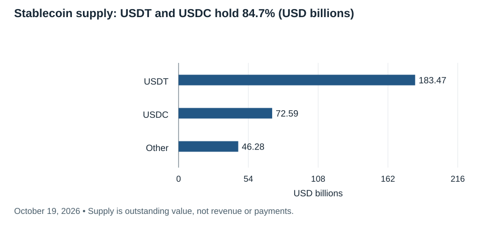

*October 19, 2026 • Supply is outstanding value, not revenue or payments.*

## 1. Start with the customer, the product, and the asset you own

Imagine a US company paying a contractor overseas. Its payroll software buys USDC, sends it over a blockchain, and the recipient either holds dollars or converts locally. The customer needs reliable receipt, reasonable FX, compliance, support, and accounting. They do not need a speculative exposure to the settlement network.

Several businesses may earn money from that one payment: the stablecoin issuer earns reserve income; the payroll provider charges for service; an exchange charges for conversion; a wallet provider charges an infrastructure fee; validators receive transaction-related compensation. The investor must identify **which of those cash flows belong to the security or token being purchased**.

A **blockchain** is a shared ledger whose participants follow rules for agreeing on balances and transactions. A **protocol** is the rule set and software interface. A **network** is the running system. A **coin** usually refers to the network’s native asset, such as ETH. A **token** can represent dollars, a financial claim, voting power, or an incentive on top of a network. These words are used loosely in marketing. [Technical foundation](https://ethereum.org/developers/docs/intro-to-ethereum/).

A **smart contract** is software that executes on the ledger: for example, releasing collateral when a debt is repaid. It does not make an external statement true, guarantee legal enforceability, or ensure its code is correct. A **dApp** combines these contracts with interfaces, wallets, APIs, and often conventional servers. Much of the useful product experience remains ordinary software. [Smart contracts](https://ethereum.org/developers/docs/smart-contracts/).

**A token is not automatically a share.** Governance rights may let holders change parameters without giving them a legal claim on profits. A buyback can support demand but can also be discretionary, offset by emissions, or held in a treasury for later spending. A stablecoin gives its holder a dollar-linked claim or exposure; it does not give ownership of its issuer.

My test for a substantive application is: **who pays, what recurring problem disappears, why is a shared ledger useful, and what survives if incentives and token prices fall?** Useful answers include settlement outside banking hours, globally portable balances, collateral usable across applications, and open access to market infrastructure. “Users trade our token” is insufficient for your real-economy mandate.

## 2. The layers: what each one does and where value can accrue

There is no official ladder in which higher-numbered layers are inherently superior. “Layer” can describe a security relationship, a software function, or marketing.

| Part of the stack | Plain-English job | Examples | Customer use / investor question |
|---|---|---|---|
| Layer 0 / interoperability | Connect networks or supply a framework for building chains | Cosmos/IBC, Polkadot | Does usage actually require the umbrella token? An IBC transfer need not create ATOM value. |
| Layer 1 | Run the base ledger and agreement rules | Bitcoin, Ethereum, Solana, BNB Chain, XRPL | Monetary transfer, asset issuance, contracts; how much demand reaches the native asset? |
| Layer 2 | Process activity outside an L1 with a specified relationship to L1 security | Base, Arbitrum, OP Mainnet; Bitcoin Lightning uses payment channels | Lower-cost execution; verify proofs, exits, data, and upgrade authority. |
| Layer 3 / appchain | Specialize execution for an application or group of applications | App-specific rollups and chains | Custom controls and economics; extra complexity needs customer justification. |
| Data availability | Make transaction data accessible so others can reconstruct or check state | Ethereum blobs, Celestia | Cheap published data; does abundant capacity commoditize pricing? |
| Oracle / messaging | Supply external data or carry authenticated messages | Chainlink, Pyth, CCIP, IBC | Price feeds for lending, cross-chain asset movement; identify the trust boundary. |
| Asset / liquidity | Provide money and financial inventory | USDC, USDT, tokenized Treasury funds | Redemption, collateral quality, legal claim, liquidity. |
| Application | Deliver a service people use | Aave, Uniswap, Hyperliquid, payment software | Fees, repeat use, margins, and token/equity capture. |
| Access and operations | Make the system usable and safe | Wallets, custody, RPC, compliance, recovery | Often a conventional subscription or transaction-fee business. |

**Execution** changes balances; **consensus** agrees on the accepted history; **settlement** establishes the result under the system’s rules; **data availability** makes the supporting information accessible. A modular design separates these functions. An integrated design keeps more together. Neither label establishes a better investment. [Scaling architecture](https://ethereum.org/developers/docs/scaling/).

**Optimistic rollups** allow challenges to invalid results. **Validity or ZK rollups** use cryptographic proofs of correct execution. “ZK” does not automatically mean user transactions are private. A **sidechain** has its own security arrangement; calling it Ethereum-compatible does not give it Ethereum’s security. **EVM-compatible** means developers can reuse much of Ethereum’s software environment. [Scaling definitions](https://ethereum.org/developers/docs/scaling/).

An **oracle** reports information that contracts cannot obtain directly, such as market prices. A lending system can have flawless contract code and still fail because a price feed is manipulated or stale. [Oracle documentation](https://ethereum.org/developers/docs/oracles/).

A **bridge** moves claims or messages between systems, often by locking an asset and issuing a representation elsewhere. Its validator, contract, custodian, and upgrade assumptions matter. Native USDC and a bridged representation of USDC can have different risk. [Bridge documentation](https://ethereum.org/developers/docs/bridges/).

The practical investment insight: **scale is useful to customers, but cheap abundant execution can compress the revenue captured by a network token.** Applications and distributors may have stronger pricing power. Conversely, a base asset can still acquire collateral or monetary demand that fee-only valuation misses.

## 3. Developer activity: Ethereum and Solana lead, but count the right thing

Electric Capital’s 2024 annual findings identify **Ethereum as the largest total developer ecosystem** and **Solana as the leader in new developers**, with Solana’s developer base growing **83% year over year**. Base accounted for **42% of newly written code in the Ethereum ecosystem** under that report’s definition. Across crypto, established developers grew **27%** while total developers declined **7%**. These are historical observations, not 2026 growth rates. [Electric Capital’s original publication](https://electriccapital.substack.com/p/2024-crypto-developer-report).

For a more current check, Chainspect’s October 19, 2026 page reports **12,268** all-time contributors for Ethereum, **10,949** for Solana, **4,112** for BNB Chain, and **1,503** for Base in selected foundation/core repositories. Its scope explicitly excludes dApps, tools, and explorers. These counts measure a different population from Electric Capital’s ecosystem research. [Current core-repository dashboard](https://chainspect.app/dashboard/developer-activity).

The chart deliberately says **all-time core contributors**, not “active app developers.” A large cumulative count can reflect age, inherited repositories, or organizational scope. Base’s lower count says little by itself about its application ecosystem. Polkadot and Kusama even show identical counts in this source, illustrating why ecosystem totals cannot simply be added.

Electric Capital fingerprints original code, removes copied/forked work and bots, and focuses on public repositories. Its current methodology uses a 28-day monthly window and sustained activity patterns over 84 days for contributor categories. Historical definitions may differ, so do not splice vintages without a methodology check. Private software is undercounted. [Methodology](https://www.developerreport.com/about).

For your strategy, the highest-priority developer ecosystems are **Ethereum plus its L2s, particularly Base, and Solana**. This is a synthesis of builder depth, deployed financial software, and verified commercial integrations. HYPE is attractive for product economics, but I have not verified a comparable application-developer count for it. XRP and Litecoin do not gain a superior software thesis simply from their large market caps or longevity.

A GP should ask portfolio companies for: retained engineers after 6/12 months; independent teams shipping production releases; paid customers outside the foundation; security response quality; and revenue after token incentives. Raw commits, GitHub stars, hackathon registrations, and wallet creation counts are weak substitutes. AI-generated code makes commit volume an even less reliable proxy for economic progress.

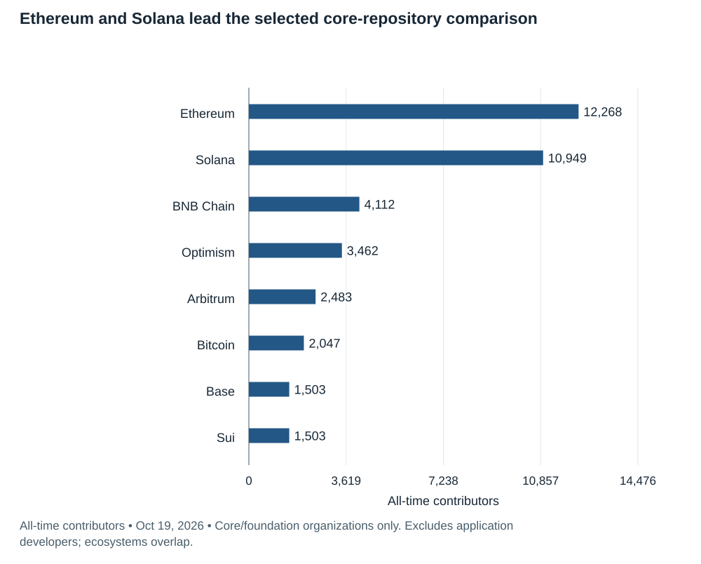

*All-time contributors • Oct 19, 2026 • Core/foundation organizations only. Excludes application developers; ecosystems overlap.*

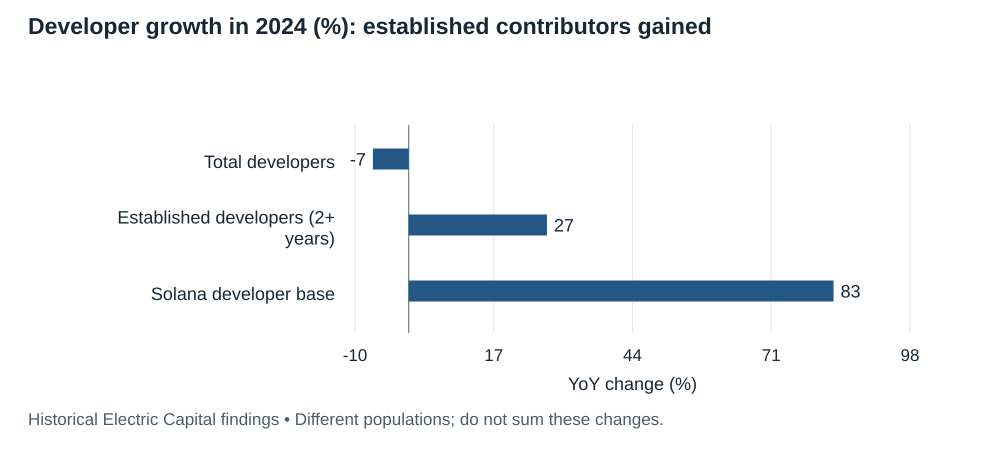

*Historical Electric Capital findings • Different populations; do not sum these changes.*

## 4. What has changed over the last few years

**2022: solvency and custody mattered as much as code.** FTX’s collapse and the broader credit failures demonstrated that a transparent blockchain does not make an intermediary’s liabilities transparent. Proof of assets alone does not establish solvency. The fund-level lesson is to underwrite custody, rehypothecation, and liquidity separately from the asset thesis. The 2023 industry review documents the subsequent recovery and enforcement aftermath. [CoinGecko 2023 report](https://assets.coingecko.com/reports/2023/CoinGecko-2023-Annual-Crypto-Industry-Report.pdf).

**2022–2024: Ethereum changed its security model and scaled through rollups.** The Merge moved Ethereum to proof of stake in September 2022; withdrawals arrived in April 2023; Dencun introduced cheaper blob data in March 2024. These developments reduced frictions for staking and high-volume software, but lower unit fees also complicated ETH’s fee-capture thesis. [Ethereum roadmap](https://ethereum.org/roadmap/).

**2024: mainstream investment access broadened.** The SEC approved spot Bitcoin ETP listings in January, and ether ETP listing rule changes in May. Access through a brokerage is an important distribution improvement; approval is not endorsement of investment merit. [SEC Bitcoin statement](https://www.sec.gov/newsroom/speeches-statements/gensler-statement-spot-bitcoin-011023), [SEC ether/Bitcoin approval chronology](https://www.sec.gov/file/34-103394).

**2025: stablecoin adoption and financial-market infrastructure expanded despite weak token returns.** CoinGecko reports a **48.9%** increase in stablecoin capitalization to **$311B** at year-end and **346%** growth in decentralized perpetual volume to **$6.7T**. Bitcoin nevertheless fell **6.4%** over the year. These are separate measures of adoption and asset performance. [2025 industry report](https://www.coingecko.com/research/publications/2025-annual-crypto-report).

**2025–2026: software usability and specialized chains became central.** Pectra added wallet functionality and validator changes in May 2025; Fusaka introduced PeerDAS in December 2025. Ethereum’s roadmap lists Glamsterdam as in development for Q4 2026, not a completed upgrade at this report date. [Roadmap](https://ethereum.org/roadmap/). Its 2026 priorities include scaling, user experience, and hardening the base layer. [Foundation update](https://blog.ethereum.org/2026/02/18/protocol-priorities-update-2026).

Solana’s October 2026 changelog shows continuing Agave/Firedancer client development and Alpenglow work in development/test environments. Client diversity can reduce correlated software failure, but a release or testnet entry does not establish production adoption or eliminate outage risk. [Solana engineering updates](https://solana.com/changelog).

The strategic transition is from selling blockspace and speculative assets toward packaging settlement, collateral, identity, and compliance into usable financial software. That transition is real in selected products; it is far from complete across the industry.

## 5. A multi-year uptrend is not a smooth investment path

The 2023 recovery was powerful: SOL rose **917.3%**, BTC about **155%**, ETH **91%**, XRP **80%**, and BNB **27%**. SOL’s starting price near $10 followed a severe collapse, so the gain is partly a low-base effect. These are calendar-year price returns, not evidence of equivalent growth in paying customers. [CoinGecko 2023, pages 6 and 24](https://assets.coingecko.com/reports/2023/CoinGecko-2023-Annual-Crypto-Industry-Report.pdf).

Bitcoin gained **121.5% in 2024**, then lost **6.4% in 2025**. Using the reported 2025 close of **$87,520** and this report’s **$81,902.66** snapshot gives approximately **−6.4% in partial 2026**. Annual and partial-year periods are labeled separately. [2024 review](https://www.coingecko.com/research/publications/2024-annual-crypto-industry-report), [2025 close, indexed primary PDF](https://assets.coingecko.com/reports/2025/CoinGecko-2025-Annual-Crypto-Industry-Report.pdf), [current BTC snapshot](https://www.coingecko.com/en/coins/bitcoin).

There is stronger evidence for a multi-year uptrend in **stablecoin supply, stablecoin software integration, and particular financial products** than for an uninterrupted price uptrend across your entire watchlist. DefiLlama’s selected snapshots move from roughly **$204B at the start of 2025** to **$305B in early December 2025**, then **$302.34B now**. That is about **48% above the first point** and slightly below the second. [2025 research](https://enterprise.defillama.com/research/report/state-of-defi-2025), [current supply](https://defillama.com/stablecoins).

Different providers and dates produce different totals: the $305B early-December DefiLlama figure and $311B CoinGecko year-end figure are not interchangeable observations. The charts preserve their source and period rather than inventing a smooth continuous series.

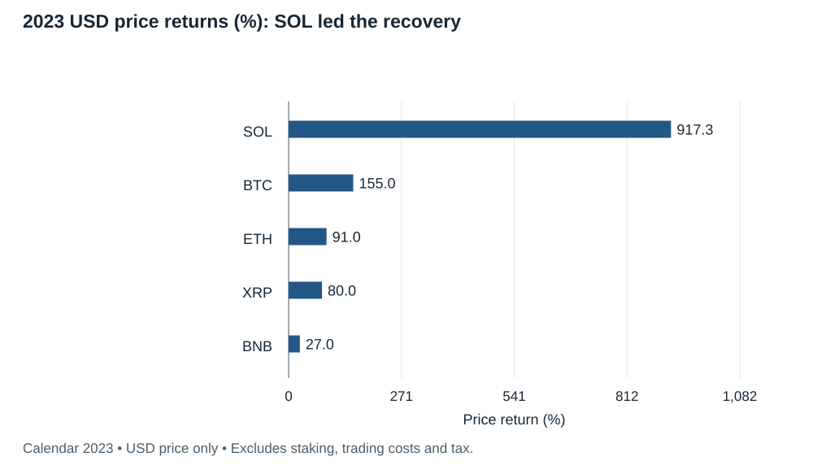

*Calendar 2023 • USD price only • Excludes staking, trading costs and tax.*

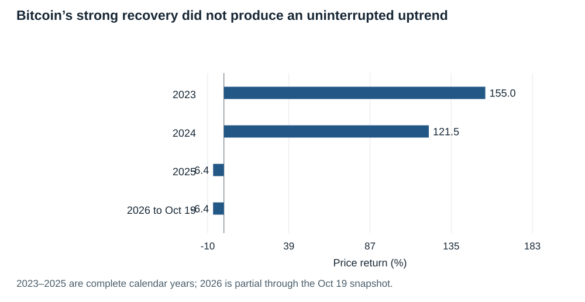

*2023–2025 are complete calendar years; 2026 is partial through the Oct 19 snapshot.*

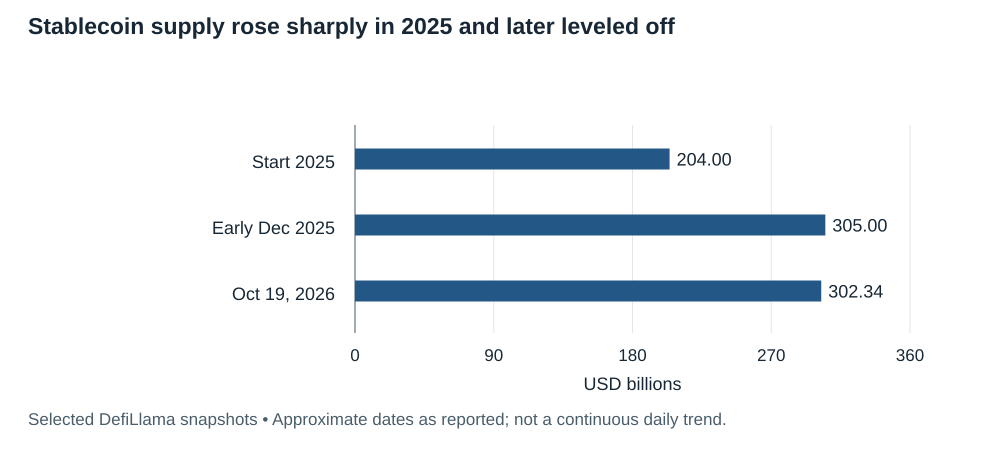

*Selected DefiLlama snapshots • Approximate dates as reported; not a continuous daily trend.*

## 6. Where applications already generate fees—and what those fees mean

The table and chart compare four applications over the same trailing-30-day convention. **Fees** are what users pay; **protocol revenue** is the provider-defined portion retained; **holder revenue** is the provider’s tracked token-holder economic stream. None is automatically corporate net income or a legally enforceable dividend.

**Hyperliquid:** $84.86M fees and $68.43M protocol revenue. It sells trading and risk-transfer infrastructure. That is real willingness to pay, but much of the end demand remains leveraged trading. It is less direct evidence for payroll, commerce, or enterprise adoption. [Source](https://defillama.com/protocol/hyperliquid).

**Uniswap:** $111.66M fees and $8.88M retained revenue in the current provider snapshot. The difference illustrates how much trading economics can flow to liquidity providers rather than the protocol. Its tracked holder-revenue stream now exists in this dataset; treating UNI as permanently “no fee capture” would be stale. Its cash flows still require careful interpretation across versions and deployments. [Source](https://defillama.com/protocol/uniswap).

**Aave:** $38.41M fees and $5.03M revenue. Borrowers pay interest; suppliers receive much of it. Lending is useful, but overcollateralized crypto borrowing can primarily fund trading rather than productive real-world credit. Horizon extends the product toward institutional collateral. [Economics](https://defillama.com/protocol/aave), [Horizon documentation](https://aave.com/docs/aave-v3/horizon).

**Morpho:** $22.23M fees and zero retained revenue under the currently tracked protocol definition. This does not mean lenders, curators, or interfaces earn nothing. It does mean that valuable lending infrastructure and MORPHO token cash flow should not be conflated. Governance can activate a fee switch capped at 25% of borrower interest; optional future monetization is not current revenue. [Economics](https://defillama.com/protocol/morpho), [governance mechanics](https://docs.morpho.org/learn/governance/organization/).

Aave also exposes a data trap: DefiLlama currently shows zero tracked holder revenue, while a February 2026 governance analysis says treasury buybacks had acquired over **205k AAVE** for about **$42M** since April 2025. Those purchases can fund future spending and emissions; they are not necessarily burns. The same post discusses adjusting the buyback budget. [Governance evidence](https://governance.aave.com/t/aave-dao-funding-insights/24192). Provider labels must be reconciled with actual treasury flows before valuation.

I have excluded meme-launch platforms from the investment shortlist even where their reported revenue is large. Excluding them from a fund mandate does not justify pretending they contribute no network fees. For ETH, SOL, or BNB, underwrite how activity and fee demand would change if speculative launches disappeared.

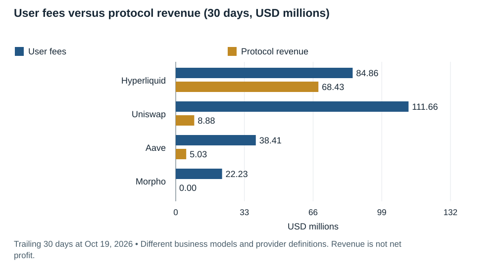

*Trailing 30 days at Oct 19, 2026 • Different business models and provider definitions. Revenue is not net profit.*

## 7. Your watchlist: what you would actually be underwriting

The accompanying market table includes circulating supply, capitalization, and an explicitly named supply denominator. Market cap is price times provider-defined circulating supply. It is not money invested, cash available to exit, or business value. **A lower unit price does not make a token cheaper.**

### Bitcoin / BTC: strongest fit for scarce monetary collateral

BTC is primarily a monetary-network thesis: limited issuance, portability, and an asset that can be held without an issuer promising redemption. Payment software and Lightning add use cases, but owning BTC does not give an income claim on those businesses. Its roughly **$1.65T** capitalization and **20.10M** circulating coins against a **21M** cap make it very different from a small application token. [Market snapshot](https://www.coingecko.com/en/coins/bitcoin).

**Bull case:** reserve/collateral demand and broader investment access. **Bear case:** monetary premium contracts, custody concentration grows, or long-run miner incentives weaken. Bitcoin has no company management team; developers, miners, users, custodians, and node operators have different powers. A mining or exchange executive cannot simply rewrite everyone’s holdings.

**Role:** a distinct monetary allocation or benchmark. **Thesis-breaker:** loss of credible scarcity/censorship resistance or enduring demand. Do not value BTC with an application price-to-sales ratio, and do not treat third-party “BTC yield” as native staking.

### Ethereum / ETH: deepest programmable-finance research priority

ETH pays for execution and data, secures proof of stake, and functions as collateral. Its **$294.9B** capitalization corresponds to about **122.1M** circulating ETH in this snapshot; there is no hard terminal cap. Net supply depends on issuance and fee burns. [Market snapshot](https://www.coingecko.com/en/coins/ethereum), [ETH mechanics](https://ethereum.org/developers/docs/intro-to-ethereum/).

**Bull case:** Ethereum becomes trusted settlement/collateral for stablecoins, tokenized funds, and many L2 applications. **Bear case:** activity grows on L2s while L1 fees and monetary demand capture too little of the value; other chains or issuer-specific networks gain share.

**Role:** broad programmable-settlement exposure. **Watch:** blob demand, burn versus issuance, collateral use, retained developers, client diversity, and concentration of stake. The Foundation influences development but is not a corporation that owns the network. L2 growth should be modeled as a mixed effect on ETH, not automatically added to ETH earnings.

### Solana / SOL: high-throughput software and distribution

SOL offers an integrated execution environment suited to rapid interactions and low-cost transfers. It has roughly **$61.2B** capitalization, **589.4M** circulating coins, and **636.0M** current total supply. Current circulation is about **92.7% of current total**, not 92.7% of a final cap; issuance continues. [Snapshot](https://www.coingecko.com/en/coins/solana).

**Bull case:** payments, exchange software, consumer wallets, and useful physical-network applications deepen together. **Bear case:** fees remain dominated by speculative trading, customer acquisition is incentive-dependent, or software/client and validator concentration produce correlated failures.

**Role:** growth exposure with greater technical and demand sensitivity. **Watch:** retained fee-paying users, stablecoin business flows, validator economics after emissions, client stake distribution, and credible production upgrades. Proof of History is a timing/ordering technique; it does not replace the network’s proof-of-stake security model.

### Base: a network opportunity with COIN and ETH as different exposures

Base is an Ethereum rollup built with OP Stack technology. It uses **ETH** for gas and has no native token in the verified L2BEAT profile. The profile also records its March 2026 separation from Superchain governance; old assumptions that every Base success directly benefits OP require rechecking. Stage 1 status is a maturity classification, not a safety rating. [Base profile](https://l2beat.com/layer2s/projects/base).

**Bull case:** Coinbase distribution and developer tools turn onchain payments and financial apps into ordinary user experiences. **Bear case:** fees commoditize, issuer-specific networks win distribution, or centralized controls create operational risk.

**Role:** COIN offers indirect exposure to Base business economics plus the rest of Coinbase; ETH offers exposure to settlement and gas demand. Neither is a pure Base tracker. A token named BASE on an exchange should not be assumed to represent this network.

### Hyperliquid / HYPE: explicit economics, demanding underwriting

Hyperliquid combines an exchange-oriented system with a broader programmable environment. Its fee documentation says the assistance fund converts fees into HYPE and burns the acquired tokens. This is a more concrete demand mechanism than vague future governance utility. Fee allocations to liquidity providers and deployers still matter. [Fee mechanics](https://hyperliquid.gitbook.io/hyperliquid-docs/trading/fees).

Current circulating cap is roughly **$17.55B**, versus provider FDV of **$75.36B** and only **222.4M** circulating HYPE against a historical **1B** cap. Remaining total is lower after burns. Unlocked, outstanding, circulating, and maximum supply are different concepts. [Snapshot](https://www.coingecko.com/en/coins/hyperliquid).

**Bull case:** exchange liquidity, distribution, and new market deployment reinforce one another. **Bear case:** competition compresses fees, derivatives restrictions reduce access, liquidation/oracle failures damage trust, or distribution overwhelms buybacks. Founder and small-team execution dependence merits substantial governance scrutiny.

**Role:** a higher-risk application investment, not a substitute for BTC’s monetary thesis. **Watch:** organic volumes, net token supply, founder/contributor distributions, actual burn transactions, liquidation losses, validator control, bridge assumptions, and the ability to reproduce critical code. Current broad developer depth remains unverified in a comparable dataset.

### BNB: established usage with concentrated ecosystem dependence

BNB has about **$95.2B** capitalization and **133.2M** circulating coins in the retrieved market snapshot. The original 200M supply is not a future unlock target: burns aim toward 100M. BNB Chain’s documentation distinguishes auto-burn from gas-fee burning. [Snapshot](https://www.coingecko.com/en/coins/bnb), [burn mechanics](https://www.bnbchain.org/en/blog/34th-bnb-burn).

**Bull case:** an established trading, stablecoin, and application ecosystem keeps attracting users. **Bear case:** dependency on Binance-linked distribution, concentrated coordination, regulatory shocks, and speculative activity.

**Role:** secondary watchlist under your preference for transparent management and risk control. BNB is not Binance equity, and exchange earnings should not be assigned directly to token holders. **Watch:** validator independence, real fee sources, upgrade authority, and the economic source of burns. Same-day burn events may make market supply snapshots lag.

### XRP: payment utility needs a stronger asset-demand bridge

XRP is the native asset of the XRP Ledger; Ripple is a company; RLUSD is a separate dollar token. XRP’s roughly **$82.5B** capitalization reflects about **63.13B** circulating units against a **100B** original cap. Ripple holdings and escrow affect float. [Snapshot](https://www.coingecko.com/en/coins/xrp).

XRPL uses a validator consensus system rather than mining or native staking. Transaction fees are destroyed, not paid as dividends. [Consensus/FAQ](https://xrpl.org/about/faq), [fees](https://xrpl.org/docs/concepts/transactions/transaction-cost).

**Bull case:** XRP becomes important bridge inventory or collateral with meaningful persistent balance demand. **Bear case:** customers choose stablecoins and direct currency pairs; rapid turnover supports large payments with limited inventory. Ripple’s commercial success is not a contractual XRP-holder claim.

**Role:** lower priority than ETH/SOL for your application-development thesis. **Watch:** payments that actually require XRP, duration of inventory held, non-subsidized liquidity, validator-list dependence, and supply releases. Headlines about Ripple partnerships do not establish those economics.

### Litecoin / LTC: credible transfer use, weaker differentiated software thesis

LTC is a proof-of-work payment asset, with about **$4.64B** capitalization and **77.73M** circulating coins against an **84M** cap. [Snapshot](https://www.coingecko.com/en/coins/litecoin).

**Bull case:** persistent transfer/payment demand supports a long-lived network. **Bear case:** stablecoins provide a dollar unit of account and Bitcoin captures the stronger monetary premium. Low fees help users but provide a limited revenue argument.

**Role:** lower priority for a fund centered on growing application revenue and software ecosystems. **Watch:** repeat merchant demand, independent development, mining concentration, and evidence for differentiation. It has no native proof-of-stake yield.

### Watchlist capitalization and supply

Indicative USD snapshot, October 19, 2026. Supply quantities below are millions of tokens.

| Asset | Price ($) | Cap ($B) | Circulating (M) | Supply denominator (M) | Share | Denominator type |
|---|---:|---:|---:|---:|---:|---|
| BTC | 81,902.6600 | 1,645.829 | 20.099 | 21.000 | 95.7% | Maximum cap |
| ETH | 2,414.1500 | 294.870 | 122.142 | 122.142 | 100.0% | Current total |
| SOL | 103.8600 | 61.216 | 589.382 | 635.967 | 92.7% | Current total |
| HYPE | 78.8800 | 17.547 | 222.446 | 1,000.000 | 22.2% | Maximum cap |
| BNB | 714.8200 | 95.189 | 133.158 | 133.158 | 100.0% | Current total |
| XRP | 1.3076 | 82.549 | 63,130.000 | 100,000.000 | 63.1% | Maximum cap |
| LTC | 59.7400 | 4.635 | 77.732 | 84.000 | 92.5% | Maximum cap |
| WLD | 0.5033 | 1.919 | 3,819.000 | 10,000.000 | 38.2% | Initial cap |

**Read the denominators:** current total is not a final supply cap. WLD’s 10B is initial supply; long-term inflation may be permitted. HYPE burns reduce remaining total. Quotes are asynchronous and rounded.

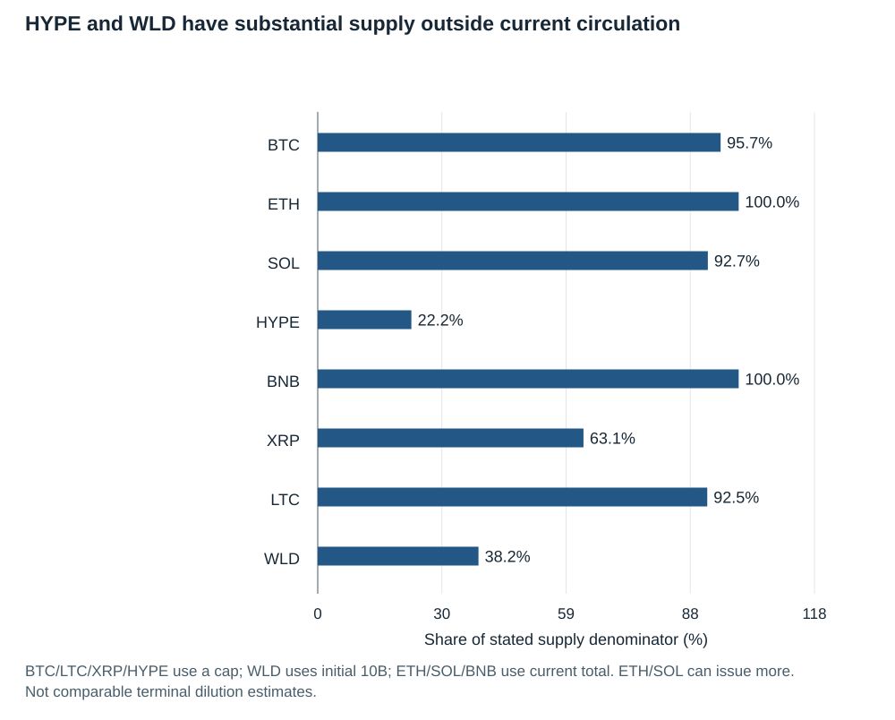

*BTC/LTC/XRP/HYPE use a cap; WLD uses initial 10B; ETH/SOL/BNB use current total. ETH/SOL can issue more. Not comparable terminal dilution estimates.*

## 8. Expand the watchlist selectively

**AAVE:** established lending economics, governance, and institutional-collateral expansion. Underwrite net DAO resources after service providers, risk costs, incentives, and treasury commitments. Founder/company and DAO interests may diverge. Its treasury buybacks should be modeled as allocations that can change, not an immutable dividend. [Governance](https://aave.com/docs/ecosystem/governance), [funding analysis](https://governance.aave.com/t/aave-dao-funding-insights/24192).

**UNI:** a major exchange-software franchise with a currently tracked retained-fee stream. Separate LP compensation, protocol fees, front-end business economics, and token-holder burns; inspect the actual scope of the enabled mechanisms. Stronger capture can improve valuation relevance while higher take rates can weaken LP or trader competitiveness. [Current economics](https://defillama.com/protocol/uniswap).

**LINK:** cross-chain messaging, oracle infrastructure, and institutional workflows are a plausible “picks and shovels” thesis. Chainlink’s Q2 2026 update describes revenue-funded LINK accumulation in its Reserve and a DTCC workflow with an expected Q4 2026 go-live. Expected launch and enterprise partnerships are not audited recurring revenue or proof of tokenholder margins. [Primary update](https://chain.link/blog/quarterly-review-q2-2026).

**MORPHO:** compelling lending architecture and distribution, but optional fee capture deserves a different valuation from current cash generation. Curator risk, collateral selection, and loan demand need market-by-market analysis. [Governance](https://docs.morpho.org/learn/governance/organization/).

**TRX / Tron and XLM / Stellar:** cannot be omitted from a stablecoin/payment map merely because ETH and SOL receive more attention. Tron is a major USDT route; Stellar is included in Visa’s settlement network. That does not make either a preferred token automatically. Governance, reserve exposure, and tiny unit transaction costs can weaken the investment bridge. [Stablecoin chain/asset dashboard](https://defillama.com/stablecoins), [Visa pilot](https://usa.visa.com/about-visa/newsroom/press-releases.releaseId.22336.html).

**ONDO / tokenization platforms:** tokenized Treasury assets can grow while the governance token captures little of the asset manager’s fees. Buying a Treasury-fund token, buying issuer equity, and buying ONDO are three different investments. Examine legal entitlement before comparing their “yield.” [RWA platform data](https://app.rwa-xyz.com/treasuries).

**SUI, AVAX, NEAR, OP, ARB, TIA, DOT:** useful research comparables for execution, specialized networks, interoperability, and data availability. I would require retained paid applications and a stronger capture mechanism before adding another infrastructure token simply for diversification. These share many macro and adoption risks with ETH/SOL; extra tickers do not necessarily diversify the portfolio.

## 9. Valuation: price the economic claim, then adjust for supply

For an application, use **normalized economic benefit to holders**, not the biggest available revenue number. Start with gross fees, subtract supplier payments, incentives, operating requirements and loss costs, identify the portion allocated to the token, and divide by the future token base. Confirm whether the benefit is a burn, distribution, staking reward, or treasury purchase.

For a network, use several lenses: fee/burn economics; collateral and monetary demand; security budget and issuance; competitive capacity; and willingness to hold inventory. A fee-only DCF can miss monetary premium; a market-size story can ignore that technology is designed to lower fees.

### HYPE: the same business looks very different on circulating cap and FDV

Annualizing $68.43M over 30 days using **365/30** gives approximately **$832.6M**. At $17.55B circulating cap, that is about **21.1× revenue**. At $75.36B provider FDV, it is about **90.5×**. These are **revenue multiples, not P/E**. [Observed revenue](https://defillama.com/protocol/hyperliquid), [capitalization and FDV](https://www.coingecko.com/en/coins/hyperliquid).

If annual revenue falls 50%, those multiples roughly double. If it rises 50%, they fall by one third. The scenario chart holds capitalization constant to show the underwriting sensitivity; it does not forecast a token price. Burn rates, costs, distributions, and valuation multiples can all change together.

A useful required-revenue calculation: **$75.36B FDV / 30× = $2.51B annual revenue**, roughly **3.0×** this observed run rate. Thirty times is an analyst-selected illustration, not a fair-value estimate. Even reaching that revenue would not make the investment automatically attractive if holders capture less, dilution increases, or the market multiple contracts.

### Stablecoin issuers: model balances, yield, and distribution together

An illustrative issuer with **$100B average reserves × 3% yield** produces **$3B gross reserve income**. At **1%**, that falls to **$1B**, before partner sharing and expenses. A **100-basis-point** rate move on $100B changes gross annual income by about **$1B**, holding balances and asset mix fixed. These are modeled sensitivities, not reported Circle forecasts.

For equities, value ordinary business cash flows and subtract net debt; assess share dilution and governance. For stablecoin issuers, do not count customers’ reserve assets as shareholder surplus cash. For token treasury companies, compare enterprise value with net asset value and the cost of leverage; a token proxy trading at a premium can lose money even if the underlying token rises.

**No price targets are warranted from these snapshots alone.** A trade-ready valuation requires a common market timestamp, latest diluted shares, net debt/cash, token unlock schedule, costs, and an explicit horizon. The report supports prioritization and valuation discipline rather than a falsely precise target.

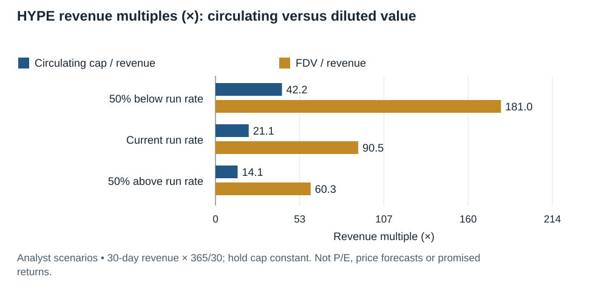

*Analyst scenarios • 30-day revenue × 365/30; hold cap constant. Not P/E, price forecasts or promised returns.*

## 10. Stablecoins and Bessent’s dollar strategy

Your premise has an explicit policy basis. In July 2025, Bessent described stablecoins as supporting the next phase of dollarization and stronger global dollar use. The GENIUS Act was signed July 18, 2025. [Treasury remarks](https://home.treasury.gov/news/press-releases/sb0216), [White House enactment fact sheet](https://www.whitehouse.gov/fact-sheets/2025/07/fact-sheet-president-donald-j-trump-signs-genius-act-into-law/).

The mechanism is straightforward: global users hold digital dollars; issuers hold eligible backing assets; software makes those balances easier to transfer. This can increase access to dollar liquidity and demand for short-duration US government assets. It does **not** guarantee permanent US reserve-currency dominance or subsidize the valuation of every network token.

Enactment and implementation are different. The statute sets effectiveness as the earlier of 18 months after enactment or 120 days after specified final implementing regulations. I have not established a complete agency-by-agency final-rule status here, so the report does not represent every provision as already effective. [US Code effective-date note](https://uscode.house.gov/view.xhtml?edition=prelim&num=0&req=granuleid%3AUSC-prelim-title12-section5906).

Also, reserve demand is not necessarily net-new demand for Treasuries: users may move money from deposits or money-market funds that already financed government debt. Dollarization, financing costs, bank funding, and monetary sovereignty can move in different directions. Countries may restrict foreign stablecoins; compliance and sanctions controls can limit open distribution.

### The actual software workflow

Consider an illustrative $1,000 international payment: the sender onboards and passes compliance checks; a payment provider acquires stablecoins; a wallet authorizes transfer; the chain settles; the recipient holds dollars or uses a local payout partner. The all-in bill includes FX, onboarding, compliance, liquidity, fraud, and cash-out. A one-cent chain fee is not a one-cent remittance cost.

Stripe’s Shopify integration enables **USDC on Base** with the merchant able to receive conventional currency. This is a concrete distribution route into commerce, but the launch announcement does not establish how many merchants use it or its revenue contribution. [Stripe announcement](https://stripe.com/newsroom/news/shopify-stripe-stablecoin-payments).

Visa reported a **$7B annualized stablecoin settlement run rate** and support for nine chains in April 2026. That is a pilot/run-rate measure, not $7B of Visa revenue or proof all card payments now settle onchain. Its multi-chain strategy also demonstrates that payment growth need not pick one winning token. [Visa release](https://usa.visa.com/about-visa/newsroom/press-releases.releaseId.22336.html).

Stripe’s 2025 annual letter estimates stablecoin payments doubled to about **$400B**, with approximately **60% B2B**. This is an industry estimate, not Stripe’s own stablecoin revenue. [Annual letter](https://assets.stripeassets.com/fzn2n1nzq965/3LlGw839Q6kUwxZlLZDtH6/75ddcbada4aa7743dd8ec7d0f9ca497e/Stripe-annual-letter-2025-desktop.pdf).

Avoid equating trillion-dollar onchain transfer measures with merchant payment volume. Transfers can include exchange inventory, arbitrage, repeated collateral movement and automation. Visa explains the need for adjusted measures; even an adjusted volume is not a count of humans or retail purchases. [Visa measurement discussion](https://corporate.visa.com/en/sites/visa-perspectives/trends-insights/making-sense-of-stablecoins.html).

## 11. Which companies, stocks, and assets benefit from dollar rails?

The following is a **mechanism-based ranking**, conditional on valuation and execution. It is not a forecast of relative stock returns.

| Exposure | Why it could benefit | What can prevent shareholder/token gains | Research priority |
|---|---|---|---|
| **Coinbase / COIN** | USDC distribution economics; custody, trading, developer access; indirect Base exposure | Rate sensitivity, Circle relationship, fee pressure, cyber incidents, dilution | High |
| **Circle / CRCL** | Reserve income; payments/connectivity products; expanding dollar utility | Distribution costs, lower rates, issuer competition, operational and governance risk | High |
| **ETH / SOL** | Settlement, collateral, security, and application ecosystems | Low unit fees, migration, dilution, value captured by applications | High, different roles |
| **LINK** | Data and interoperability services across multiple chains | Announcements fail to monetize; service revenue does not translate adequately into LINK demand | Selective |
| **Visa / V and Mastercard / MA** | Distribution, settlement orchestration, compliance and acceptance relationships | Fee compression or disintermediation; crypto too small relative to overall business | Diversified exposure |
| **BlackRock / BLK; Franklin / BEN; BNY / BK** | Asset management, tokenized funds, reserve management/custody | Low fees, small contribution relative to group, competition | Indirect exposure |
| **PayPal / PYPL and Shopify / SHOP** | Wallet/merchant distribution and stablecoin-enabled services | Product use may add little margin; broader business and corporate-event risk | Re-underwrite current corporate situation |
| **HOOD / GLXY / CME** | Trading, institutional services, derivatives or infrastructure activity | More exposure to risk appetite than to business payments; regulatory/counterparty risks | Secondary to the dollar-payments thesis |
| **Private payment and wallet software** | Recurring fees for integration, treasury, local payouts, security | Distribution dependence, licensing, customer concentration, take-rate compression | Strong venture fit |

COIN and CRCL offer the most direct public-market starting points here because their reports identify existing relevant income. Circle’s Q2 2026 release reports **$701M revenue/reserve income**, **$412M distribution/transaction/other costs**, **$254M operating expenses**, **$48M net income**, and **$143M adjusted EBITDA**. USDC quarter-end supply was **$73.3B**. These figures are rounded and do not form a complete accounting bridge. [Circle results](https://www.circle.com/pressroom/circle-reports-second-quarter-2026-results).

The implication is critical: **owning distribution may be as valuable as issuing the dollar.** Evaluate which company keeps the economics after incentives, customer acquisition, and partner sharing. Circle’s $668M reserve income is not interchangeable with net profit; Coinbase’s participation is a cost to one company and revenue to another. Adding both gross streams would double-count parts of the same economic chain.

Coinbase reported **$1.220B total revenue** in Q2 2026, with **$599M transaction revenue** and **$555M subscription/services revenue**. Its stablecoin line is included within subscription/services. Its prior-year stablecoin comparison was restated to move corporate-balance earnings elsewhere. [10-Q](https://www.sec.gov/Archives/edgar/data/1679788/000167978826000088/coin-20260630.htm). A more diversified revenue mix can coexist with declining absolute revenue.

For Visa, the primary pilot release verifies activity. For the other diversified equities, the table states plausible business mechanisms, not verified material earnings contributions or current valuation recommendations. Latest filings, corporate actions, equity capitalization and business-segment exposure must be checked before purchase. Stripe, its subsidiaries, and other private infrastructure companies should be accessed through verified private-market rights rather than unofficial lookalike tokens.

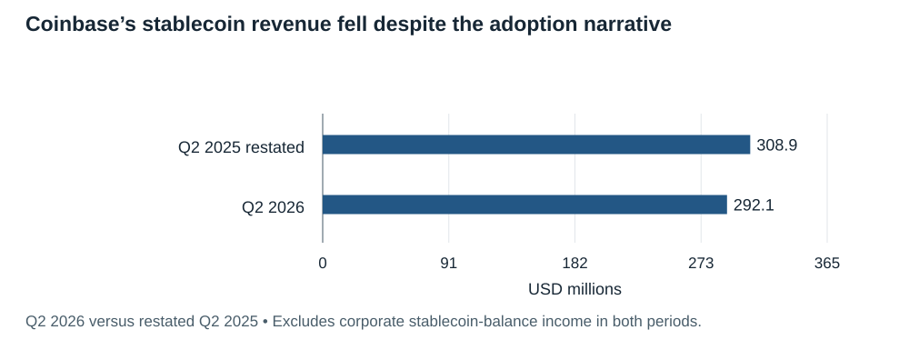

*Q2 2026 versus restated Q2 2025 • Excludes corporate stablecoin-balance income in both periods.*

## 12. Tokenization and physical infrastructure: useful applications beyond trading

A **real-world asset token** is a digital representation of a claim involving something outside the chain: Treasury funds, loans, real estate, or securities. The token can improve transfer, collateral use and recordkeeping. Its economic rights still depend on documents, custodians, courts, eligibility rules, and redemption procedures.

RWA.xyz’s current Treasury-platform table shows about **$3.0B for Ondo**, **$2.5B for Franklin’s Benji**, **$2.4B for Circle**, **$2.3B for Securitize**, and **$1.1B for WisdomTree**. These are platform asset values, not revenue, and the selected platforms are not the complete market. [Treasury league table](https://app.rwa-xyz.com/treasuries).

A simple example: a business holds a tokenized Treasury-fund interest, earns the underlying fund return, and may pledge it as collateral. The manager collects a management fee; a custodian safeguards assets; a chain records transfers. The manager’s governance token, if any, may have no claim on that fee. Fund NAV, platform AUM, stablecoin supply and token capitalization must stay separate.

For institutional adoption, permissioning and selective disclosure can be features: a regulated fund may need investor checks, transfer restrictions and recovery mechanisms. Fully public visibility is not the only legitimate design. A private database is often adequate when one trusted operator controls every participant; a shared ledger needs to justify its added coordination benefit.

**DePIN** means decentralized physical infrastructure. Helium is a concrete case: carriers pay to move subscriber data through Wi-Fi infrastructure supplied by participants. Its September 2026 announcement describes a **$0.10/GB base pay rate**, venue multipliers up to five, and a target minimum deployer share rising to **80%**. These are commercial/reward parameters, not network-wide realized margins. [Helium economics](https://www.helium.com/blog/hip-150-higher-earnings).

That example highlights the diligence question: are external customers paying more than the system spends attracting and rewarding supply? Separate customer cash receipts, data-credit burns, token emissions, treasury-funded support and deployer profit. A venue can earn income while an HNT investor loses money. I would study such applications for venture opportunities, but not infer an HNT buy recommendation without complete demand, margin, concentration, and emission data.

Prediction markets also charge for information aggregation and risk transfer; their growth can be commercially meaningful. But gambling-adjacent regulation and speculative end demand make them a separate mandate choice. For your stated preference, payroll, B2B settlement, treasury, collateral software, identity and security are the cleaner narrative anchors.

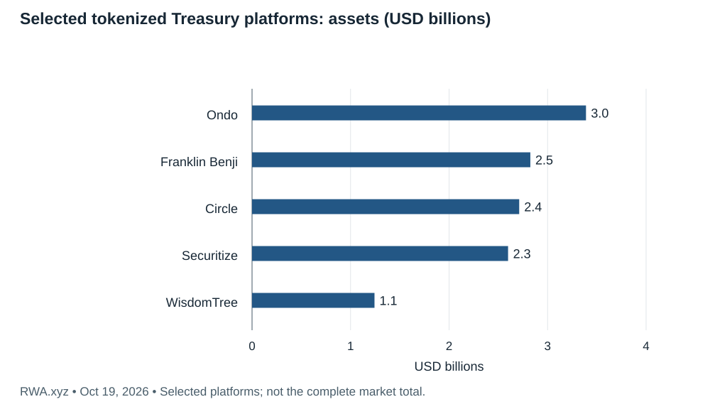

*RWA.xyz • Oct 19, 2026 • Selected platforms; not the complete market total.*

## 13. AI identity: bullish on the problem, selective about the token

Your intuition is strong on the **need**: when software can cheaply imitate conversation, images and voices, platforms need better ways to establish who is acting and under whose authority. The investment error would be assuming the problem necessarily produces one global crypto-token winner.

There are at least five different jobs:

| Job | What it establishes | What it does not establish |
|---|---|---|
| Authentication | Control of a credential/account now | Unique human, legal identity, honesty |
| Proof of personhood | A credential corresponds to a distinct human | That every action is human-authored or non-malicious |
| Identity / KYC | An identity claim or regulated onboarding check | Future intent, safe custody, permission for every action |
| Agent authorization | What an agent may do for a person/organization | That all resulting outputs are truthful |
| Content provenance | Origin/edit history linked to a signer | The factual truth of the content |

World combines **World ID** credentials, **Orb** enrollment, a **World App** experience, **World Chain**, and the **WLD** token. Buying WLD is not buying shares in Tools for Humanity or automatic ownership of the identity product’s earnings.

World’s public product page reports **18M+ verified humans** and **150M+ credential uses**, with partner uses including Tinder and Zoom. These are vendor-reported adoption measures, not independently audited paying customers or revenue. [World product page](https://world.org/world-for-you).

Its April 2026 fee discussion describes World ID 4.0 enabling application fees, including credential and protocol components, with possible allocation to operations or burns. It discusses fees being enabled and configurable mechanisms; **this report did not verify a live recurring-fee run rate or a mandatory fixed share accruing to WLD holders**. The article’s example pricing is a hypothetical, not reported sales. [World’s fee model](https://world.org/blog/announcements/world-id-fees-the-revenue-potential-from-world-id).

That distinction matters at approximately **$1.92B circulating capitalization** and **$5.02B initial-supply FDV**, with **3.819B of 10B initial WLD** circulating. Roughly **61.8% of the initial base is outside circulating supply**; that is not the same as all being immediately unlocked. Governance may allow inflation after 2038, so “10B forever” is inaccurate. [Market data](https://www.coingecko.com/en/coins/worldcoin), [tokenomics](https://whitepaper.world.org/designing-for-scale/2025-04-30).

### What would make WLD investable under this mandate?

I would require: paid integrations renewing after subsidies; verified active users in those integrations; collected fees and their denomination; an enforced token-demand/burn path; net issuance after grants and distributions; manageable enrollment costs; and credible independent privacy/security assessment. Also test device compromise, credential transfer or rental, coercion, recovery, duplicate enrollment, false positives, and regional access restrictions.

An illustrative scenario shows why this matters: **10M paying active users × $0.10/month = $12M annual gross fees**. At **100M × $0.25/month**, gross fees reach **$300M**. If only 20% in the latter case were burned, the token benefit would be **$60M**, before other token flows. These are analyst-selected scenarios, not guidance or inferred revenue from enrollment totals.

Against $5.02B initial-supply FDV, the first scenario is about **419× gross fees**; the second about **16.7× gross fees**, but **83.7× the assumed burn benefit**. Credential issuers, operators and protocol holders may receive different portions. Enterprise adoption alone does not answer valuation.

### Crypto helps some trust problems; it is not required for all of them

A blockchain can make issuer registries, revocation state and payments portable across organizations. Zero-knowledge proofs can reveal a useful attribute while concealing unnecessary personal data. Enrollment still depends on hardware, people, institutions and recovery processes. Cryptography does not remove those trust boundaries.

W3C verifiable credentials define an issuer–holder–verifier model for digitally signed claims; the standard does not require buying a public token. [W3C standard](https://www.w3.org/TR/vc-data-model-2.0/). C2PA content credentials similarly document provenance and explicitly do not require a blockchain; provenance is not a truth guarantee. [C2PA explainer](https://spec.c2pa.org/specifications/specifications/2.2/explainer/Explainer.html).

My conclusion: **WLD is a small, milestone-dependent research option; identity and authorization software may be the better venture expression.** An attractive startup could sell proof orchestration, policy, recovery, anti-fraud measurement or agent spending controls across multiple credential systems. Token candidates such as ENS, EAS-related infrastructure and other identity projects need the same economic-capture test; there is no verified alternative token winner established by this report.

## 14. AI agents: money movement and authorization may matter more than “AI coins”

Agents need wallets or accounts, spending limits, merchant authentication, delegated permissions, receipts, refunds, and accounting. A crypto rail can let software pay for an API or digital service without a conventional subscription contract. That solves a specific transaction problem; it does not mean the entire AI workload belongs on a blockchain.

Coinbase’s Q2 2026 release claims more than **90%** of observed agentic stablecoin volume ran on Base and more than **97%** of onchain agentic transactions used x402. These are company-reported shares of a defined emerging category, with limited independent denominator visibility. They are not shares of all AI commerce, nor proof of large recurring profit. [Coinbase release](https://investor.coinbase.com/news/news-details/2026/Coinbase-Q2-Earnings-Everything-Exchange-Drives-3rd-Consecutive-Quarter-of-Record-Crypto-Trading-Volume-Market-Share-Revenue-Diversification-and-Resilience/default.aspx).

The more defensible investment question is: can a provider charge for secure, compliant, auditable agent activity as usage scales? **Policy and identity can remain valuable even if payment fees fall.** Useful metrics are net externally paid service volume, recurring commercial users, cost per authorized action, fraud losses, refund rates, and retained take rate—not self-transfers between experimental agents.

Your stablecoin and identity theses therefore fit together at the software layer: **who is authorized to spend digital dollars, on what, within which limits, and with what recovery path?** That is a coherent fund theme. It does not require a portfolio of tokens that merely contain “AI” in their branding.

## 15. Staking: what the yield pays you for

**Staking** commits an asset to support a proof-of-stake network’s security. Compensation can include newly issued tokens and transaction-related rewards. Delegation lets an operator perform the technical work while the holder bears some combination of operational, liquidity and protocol risks. Rates change; this report does not treat a displayed APY as guaranteed.

Ethereum solo validation generally requires at least **32 ETH**; pooled arrangements allow smaller positions but add contracts, operators, or custodians. Liquid-staking tokens represent a claim on staked assets and can trade away from that claim’s redemption value. Slashing, downtime penalties, queues and withdrawal-key security differ by arrangement. [Ethereum staking](https://ethereum.org/staking/).

**Restaking** makes an already committed asset support additional services. It can earn additional rewards but adds failure, correlation and contractual complexity. **Liquid restaking** adds another token/contract wrapper. More yield can represent more exposure to the same collateral, rather than a new independent profit source.

For ETH, SOL, BNB and HYPE, inspect each network’s actual reward and unstaking rules rather than generalizing Ethereum’s design. **BTC and LTC use proof of work; XRP is not native proof of stake.** A yield product using those assets is lending, market making, wrapping, or another arrangement with its own risk.

Two calculations help:

- **Illustrative ownership yield:** at 7% token rewards and 4% aggregate supply growth, `(1.07 / 1.04) − 1 ≈ 2.9%` before commissions, costs and tax. This measures change in ownership share, not dollar profit.
- **Illustrative dollar outcome:** a token falls 50% while you earn 7% more units; your dollar value becomes `0.50 × 1.07 = 0.535`, a **46.5% loss** before costs.

A solo GP should distinguish passive delegated staking from running validators, lending staked-token collateral, borrowing against it, and looping that borrowing. Each step changes the risk budget. A high yield sourced mainly from issuance or incentives should not be valued as stable business earnings.

## 16. Cybersecurity and management risk: use evidence and loss budgets

There is **no defensible measured probability such as “ETH has 3% hack risk” or “HYPE has 18% management risk”** in the reviewed sources. Cyber attacks are adaptive, exposures change, and failure denominators are poorly defined. Giving such percentages would create false precision.

Chainalysis estimates more than **$3.4B stolen in 2025**. The FBI attributed the approximately **$1.5B Bybit theft** to North Korea. Those figures establish material operational threats; dividing them by total crypto market cap does not estimate the probability your position is stolen. The relevant exposure is your custody and application path. [Chainalysis](https://www.chainalysis.com/blog/crypto-hacking-stolen-funds-2026-/), [FBI notice](https://www.ic3.gov/PSA/2025/PSA250226).

### The risk changes with how you hold the same asset

Holding ETH in well-controlled custody, staking it through a service, depositing a liquid-staking token in a lending market, and bridging that claim to another chain create different exposures. A secure base ledger does not rescue a compromised wallet, malicious upgrade or insolvent intermediary.

Separate **consensus failure; contract bugs; oracle and liquidation design; bridge validation; signer/key compromise; front-end and software supply chain; custody insolvency; stablecoin redemption; governance capture; and market liquidity**. One “security score” obscures which party can lose or freeze the money.

### Ordinal assessments for the requested watchlist

The following grades are **analyst judgments for prioritizing diligence**, not probabilities or vendor certifications. “Lower” is relative to this crypto set. An unresolved question can justify a higher diligence burden even without evidence of misconduct.

| Asset / route | Technical and operational concern | Governance / execution dependence | Valuation and economic concern | Principal diligence focus |
|---|---|---|---|---|
| BTC held directly | Lower base-protocol complexity; key/custody risk remains | Lower issuer dependence; mining/custody concentration | High monetary-premium volatility | Custody, liquidity, mining incentives |
| ETH held directly | Medium; complex multi-client consensus | Medium; distributed development and stake concentration | High fee-capture/monetary uncertainty | Clients, staking entities, burn/issuance |
| SOL held directly | Medium–high; performance/client rollout risk | Medium–high validator/core-team dependence | High demand cyclicality and issuance | Client stake, outage response, real fee mix |
| HYPE held directly | High diligence burden; exchange, consensus and bridge stack | High team/validator and market-policy dependence | High dilution and revenue concentration | Reproducible code, control rights, token flows |
| Base application deposit | High incremental contract/upgrade/bridge exposure | High coordinator/security-council dependence | Depends on the application, not a Base token | Exit path, privileged upgrades, sequencer |
| BNB | Medium–high ecosystem/contract exposure | High Binance-linked coordination/distribution | High concentration and speculative demand | Validator control, policy, burn economics |
| XRP | Medium; consensus-list and integration assumptions | Medium–high issuer/distribution influence | High capture/float uncertainty | Required XRP balances, escrow, validator lists |
| LTC | Medium; mining and custody exposure | Medium smaller development/mining ecosystem | High relative-demand uncertainty | Mining concentration, differentiated demand |
| WLD | High credential/hardware/privacy/recovery complexity | High foundation/TFH/enrollment dependence | Very high monetization and dilution uncertainty | Paid fees, biometrics controls, unlocks |
| COIN / CRCL equity | High operational, partner and custody diligence | High corporate-management dependence | High rate/valuation/competition sensitivity | Filings, board controls, costs, incident handling |

For Base specifically, L2BEAT documents **instant upgrade authority without an exit delay**, requiring two governing parties. That is a concrete control risk; “secured by Ethereum” is not a complete deposit-risk description. A mature proof system can coexist with dangerous privileged upgrades. [Risk analysis](https://l2beat.com/layer2s/projects/base).

### How to turn uncertainty into percentages honestly

Use percentages for **exposure and modeled loss**, not invented attack probabilities. If a fund caps one application deposit at **3% of NAV**, complete unrecovered loss of that deposit costs **3% of NAV**, before contagion. A **10% NAV** token position falling **60%** costs **6% of NAV**. These are arithmetic stress tests, not forecasts.

Expected loss can be written `exposure × probability × loss given event`, but the probability requires explicit assumptions. Illustratively, `3% × 5% × 100% = 0.15% NAV` annual expected loss only **if** the assumed 5% annual event probability is accepted; that probability is not estimated here. Tail loss remains 3%.

For management diligence, require the actual power map: who can upgrade, pause, move treasury assets, change fees, issue supply, and replace signers? Assess succession, conflicts between company and token holders, treasury runway, vesting, legal entities, emergency history and incident transparency. Famous founders and audits are evidence inputs, not guarantees.

## 17. A solo GP fund narrative that LPs can underwrite

**Proposed positioning:** “We invest in the software and financial infrastructure that makes digital dollars, assets, and authorized identities usable globally. We buy economic rights supported by retained customers, measurable cash generation, or tightly defined milestones.”

The story has three complementary engines:

1. **Dollar distribution and financial operations:** payment orchestration, treasury, compliance, local payouts, custody and collateral workflows. This is the strongest match to the Bessent thesis and can be expressed through equity as well as tokens.
2. **Productive public networks and applications:** selectively own settlement assets and applications when usage reaches the asset through fees, burns, collateral or enforceable rights. Treat crypto trading businesses honestly as financial-market exposure.
3. **Trust for the AI economy:** identity, authorization, recovery and agent controls. Use milestones and small initial exposure where monetization is unproven.

BTC can serve as a monetary benchmark or separate reserve thesis, but it should not be described to LPs as recurring application-revenue exposure. Likewise, a private venture fund and a liquid-token strategy need different liquidity, valuation, custody and reporting structures. Do not fund illiquid venture commitments with redeemable short-term capital.

### What would constitute a solo-manager edge?

A credible edge could be access to payment/product founders, the ability to inspect software and customer economics, disciplined token-supply analysis, or a repeatable security-control review. “Crypto will be bigger” is market beta, which LPs can buy inexpensively. Explain what you can underwrite that a token index cannot.

A manager should own investment decisions, but should not also be the only person capable of authorizing transfers and valuing positions. Design independent transaction approval and recovery, separate trading/treasury permissions, use an appropriate custodian and independent administration, and reconcile positions and protocol receivables. Obtain security expertise for code/control diligence; the GP need not personally audit every contract.

### Illustrative underwriting scorecard—not a return model

One possible investment committee rubric assigns **25% to retained paid demand, 20% to token/equity capture, 20% to security/control quality, 15% to valuation/dilution, 10% to developer retention, and 10% to governance alignment**. These are proposed weights, not empirically calibrated predictors.

Hard fail conditions should override a good average: unresolvable custody/control ownership; a token with no plausible capture path; unverifiable critical accounting; or liquidity that cannot support the fund’s terms. A cheap valuation cannot compensate for not knowing what you own.

### Illustrative loss limits and portfolio construction

Instead of prescribing personal weights, design limits from acceptable permanent loss. If the fund can tolerate at most **1% NAV permanent loss from one early application**, a 100%-loss stress implies at most **1% direct exposure**, not a claim the investment is safe. Larger mature positions require explicit justification and correlated scenario analysis.

Aggregate exposures across common failure domains: USDC issuer, one custodian, an Ethereum bridge, an oracle, a validator operator, a trading venue, and dollar interest rates. COIN + CRCL + ETH + Base lending can be four tickers but one correlated adoption/operational complex. Token prices may all fall together when liquidity disappears.

For an initial research pipeline I would advance **COIN, CRCL, ETH, SOL and HYPE** to individual investment memos; then **AAVE, UNI and LINK**; then **WLD** only against explicit commercialization milestones. BNB, XRP and LTC remain comparison cases rather than default core holdings for this particular narrative.

### What would falsify the fund thesis?

Stablecoin volume grows but software take rates and margins collapse; issuers capture benefits through new networks that bypass your investments; companies report integrations without paying customers; token distributions persistently exceed economic capture; independent security cannot verify controls; or identity adoption does not translate to paid recurring use. These are operating reasons to reconsider—not merely temporary price weakness.

## 18. An operating dashboard and a practical diligence agenda

Track the following monthly using consistent definitions; this report is a dated research artifact, not an automatically refreshed trading monitor.

| Question | Useful measure | Common misleading substitute |
|---|---|---|
| Are businesses adopting stablecoins? | Paid B2B/merchant flows, repeat cohorts, net retention, realized take rate | Raw transfer volume or minted supply alone |
| Are builders staying? | Retained independent production teams and sustained original contributors | Stars, commits or hackathon sign-ups |
| Does the token benefit? | Realized burns/distributions less issuance and treasury re-sales | Gross app revenue |
| Is lending productive and resilient? | Borrow utilization, payer type, net spread, bad debt, collateral concentration | TVL alone |
| Is the chain reliable? | Client stake distribution, finality incidents, recovery time | Peak TPS benchmark |
| Is identity monetizing? | Paid active proofs/users, renewal, fraud reduction, enrollment economics | Total Orb registrations |
| Is risk within limits? | Exposure by issuer/custodian/bridge/oracle, executable liquidity | Number of coins held |

For each candidate, the investment memo should include: product/customer map; original-source financial reconciliation; developer cohort definitions; current supply and next-12-month distribution; governance/control diagram; operational stress cases; valuation under bear/base/bull assumptions; and clear thesis-breakers.

For your watchlist, the most decision-relevant unresolved work is **asset-specific valuation and control verification**, not another generic sector overview. For HYPE, reconcile distributions versus burns and examine exchange control surfaces. For WLD, verify collected fees and enforceable token allocation. For COIN/CRCL, build a common rate/balance/distribution model and check the latest share base and corporate developments.

## 19. Glossary and measurement rules

| Term | Meaning that matters for investing |
|---|---|
| Market cap | Price × circulating supply; not an exit value or enterprise valuation. |
| FDV | Price × provider-chosen total/max supply; inspect the denominator and timing. |
| Float | Tokens actually available to trade; can be narrower than circulation. |
| Unlock | Transfer restrictions expire; does not prove immediate sale or circulation. |
| Emissions | New token distribution; can dilute holders even when presented as yield. |
| Burn | Verifiable removal from usable supply; offset against new issuance. |
| Gas | Payment for network computation/resources, often abstracted from end users. |
| TVL | Assets deposited under a provider definition; price-sensitive and potentially double-counted. |
| AUM / NAV | Assets managed / net asset value; neither is revenue. |
| DEX / AMM | Exchange without a conventional central matching operator / algorithmic liquidity pools. |
| Perpetual future | Leveraged derivative without expiry; funding payments help anchor price. |
| MEV | Value captured through ordering/inclusion of transactions; can benefit validators while harming users. |
| Slashing | Penalty for specified validator misbehavior; not a universal remedy for every loss. |
| Multisig / timelock | Several approvals / delayed execution; effectiveness depends on independence and scope. |
| Sequencer | Orders rollup transactions; control, outage fallback and censorship resistance matter. |
| Finality | Degree of assurance a transaction will not be reversed under network rules. |
| APY / APR | Compounded / simple annualized rate; verify reward source and price exposure. |
| Sybil resistance | Limits one actor pretending to be many; does not establish honesty. |
| DAO | Governance arrangement implemented through rules, votes and contracts; concentration can remain. |

MEV is an economic design issue, not just a software performance statistic. A validator can earn more while traders receive worse execution. [MEV documentation](https://ethereum.org/developers/docs/mev/).

## 20. Methods, evidence boundaries, and source guide

**Evidence hierarchy:** official protocol documentation for mechanics; SEC/company filings for corporate accounts; original developer research for builder measures; and specialist onchain providers for protocol economics, supply and tokenized assets. Company adoption claims are self-reported. Analytical rankings, stress cases, proposed fund rules and investment interpretations are labeled judgments or scenarios.

**Freshness:** market/protocol pages were retrieved October 19, 2026, with some search-indexed quotes from October 18. They are asynchronous and rounded. Corporate financial periods end June 30, 2026. Electric Capital annual findings refer to 2024; the current Chainspect comparison uses all-time core repositories. These periods should not be merged into one “2026 developer CAGR.”

**Coverage:** this is a map of the main investable architectures and your requested assets, not a census of every protocol. It establishes commercial examples and a research ranking; it does not establish which application has the most revenue-producing developers because no reviewed dataset joins individual engineers to non-speculative customer revenue across chains.

**Data reconciliation:** XRP’s retrieved page mixed a CAD header with USD body figures; the market table uses its explicitly USD market cap and an approximate implied USD price. Bitcoin/Litecoin provider FDV may use current total rather than eventual mining caps. BNB’s original supply is not future dilution. SOL/ETH have ongoing supply policies. HYPE burns lower remaining total. WLD has a 10B initial base with possible later governance inflation.

**Revenue boundaries:** DefiLlama values are tracked fee definitions, not audited net income. Supplier interest, staking issuance, reserve income, treasury buybacks and cash dividends are different things. Do not aggregate overlapping chain and app fees as independent sector revenue. Aave’s tracked holder-revenue zero does not nullify its separately documented treasury buybacks.

**Reproducibility:** each chart and data table exposes source links, period, reviewed rows, caveats and calculations through its source action. The report’s assumptions do not write back to source systems. Core formulas: HYPE annualization = 30-day revenue × 365/30; supply share = circulating / explicitly labeled denominator; percentage change = current/prior − 1; partial 2026 BTC return = current snapshot / reported 2025 close − 1.

Primary reading paths: [Electric Capital](https://electriccapital.substack.com/p/2024-crypto-developer-report), [developer methodology](https://www.developerreport.com/about), [Chainspect](https://chainspect.app/dashboard/developer-activity), [DefiLlama fees](https://defillama.com/fees), [stablecoins](https://defillama.com/stablecoins), [Coinbase filing](https://www.sec.gov/Archives/edgar/data/1679788/000167978826000088/coin-20260630.htm), [Circle results](https://www.circle.com/pressroom/circle-reports-second-quarter-2026-results), [Ethereum roadmap](https://ethereum.org/roadmap/), [L2BEAT Base](https://l2beat.com/layer2s/projects/base), [Treasury dollar policy](https://home.treasury.gov/news/press-releases/sb0216), [World fees](https://world.org/blog/announcements/world-id-fees-the-revenue-potential-from-world-id), and [RWA.xyz](https://app.rwa-xyz.com/treasuries).
