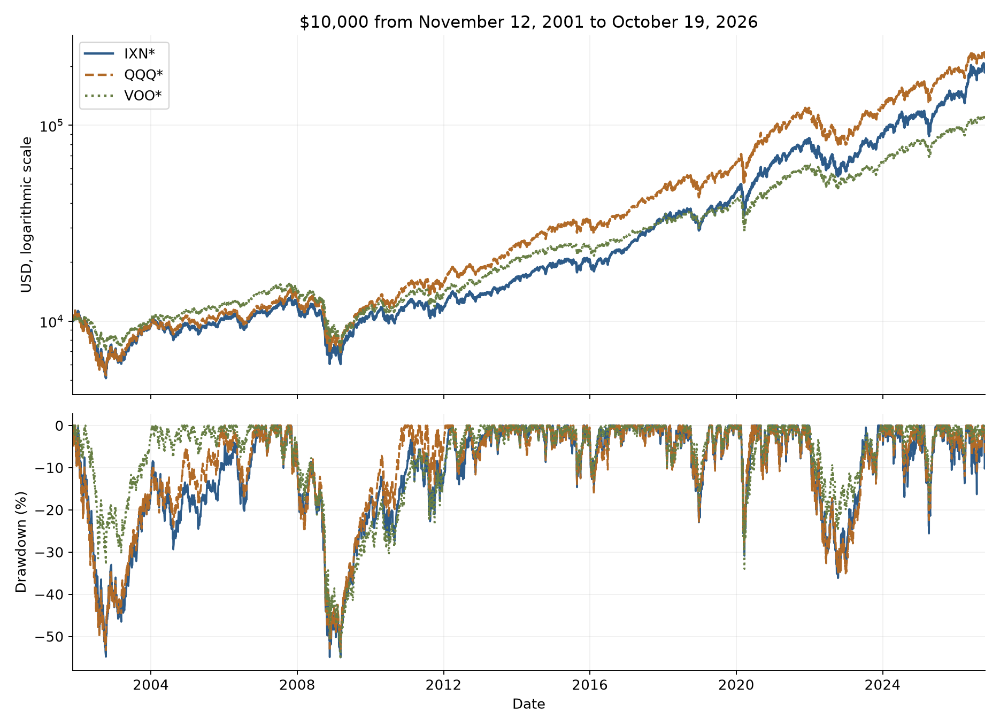
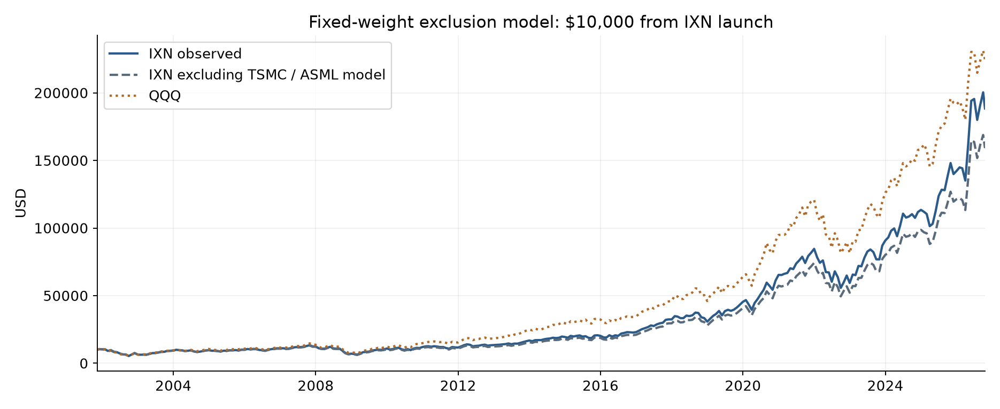

# QQQ for broad AI growth; IXN for a larger bet on global technology

Research cutoff: October 19, 2026. [Interactive report](https://arpit-sidana.github.io/investments/reports/ixn-qqq-voo-2026-10-19/) · [Offline HTML](https://arpit-sidana.github.io/investments/downloads/ixn-qqq-voo-2026-10-19.html)

## Executive Summary

- **QQQ is the stronger default for a long-term AI growth allocation; IXN is the more concentrated global technology tilt.** Since IXN launched on November 12, 2001, $10k became about **$224.6k in QQQ**, **$188.5k in IXN** and **$108.2k in the VOO/index splice**. Annualized returns were 13.29%, 12.50% and 10.02%, respectively.
- **IXN leads the recent cycle but is less diversified by weight.** Its trailing 10-year CAGR was 23.45%, against QQQ’s 20.63%. Yet 130 IXN equity lines amount to only **17.4 equally weighted holdings** by concentration, versus 29.7 for QQQ and 40.8 for VOO. Global listings do not remove shared technology risk.
- **The semiconductor advantage is real exposure, not proven historical attribution.** Removing TSMC and ASML at constant current weights lowers modeled IXN inception-to-date CAGR from 12.50% to 11.74%. That model cannot establish their actual historical contribution. Expanding an unchanged technology factor to 1,200 synthetic stocks barely reduces volatility.
- **The higher fee buys a different portfolio, not a return guarantee.** IXN costs 0.37% versus QQQ’s 0.18% and VOO’s 0.03%. Prefer IXN when you deliberately want more foundry, memory and equipment exposure; prefer QQQ for a broader mix of AI infrastructure and monetization, and VOO for the broad US equity core.

## 1. What you actually own

The initial holding-count premise needs correcting: **IXN has about 130 equity positions, QQQ 101 equity lines representing 100 issuers, and VOO 505 lines** in these snapshots. IXN does not spread capital across 1,200 stocks.

IXN tracks global information technology. That includes Nvidia, Apple, Microsoft, TSMC, ASML, Samsung and SK Hynix, but excludes major AI beneficiaries classified outside information technology. QQQ selects large nonfinancial Nasdaq-listed companies; it is exchange- and index-rule driven, rather than a pure technology or comprehensive innovation portfolio. VOO spans US large-cap sectors.

**IXN’s additional geography is useful but economically concentrated.** About 77.12% is US exposure, with Taiwan 6.91%, Korea 5.49%, Japan 3.90% and the Netherlands 2.74%. Semiconductors and equipment account for 47.78%, hardware 28.13%, and software/services 23.84%. QQQ’s 68.01% technology allocation uses ICB classification and is not directly comparable to IXN’s GICS figures.

QQQ adds Amazon, Alphabet and Meta, together about 13.69%, which IXN omits. IXN instead adds TSMC, Samsung, SK Hynix and Oracle; QQQ already owns ASML at about 0.67%. VOO also holds suppliers outside technology, including Eaton, Vertiv and GE Vernova. No fund captures the whole AI chain: private firms, utilities, power equipment, construction and data-center assets have different coverage.

| Fund | Fee | Equity lines | P/E date |
| --- | --- | --- | --- |
| IXN | 0.37% | 130 | 2026-10-16 |
| QQQ | 0.18% | 101 | 2026-09-30 |
| VOO | 0.03% | 505 | 2026-06-30 |

## 2. Performance depends heavily on the starting valuation

Select a start window below. **The 1990 and 2000 IXN lines are active US technology proxies before IXN existed, not a reconstructed global IXN backtest.** The 1990 QQQ segment uses a price index before launch and omits dividends; VOO uses a fee-adjusted S&P 500 total-return index before September 2010. January 1 windows begin at the preceding available year-end close. Every retrospective window ends October 19, 2026.

QQQ wins the common inception window and the 2000 and 2010 spliced windows. The technology proxy wins from 1990, but its different strategy and the QQQ dividend omission prevent interpreting that result as evidence that historical IXN beat QQQ. Assuming 0.25% or 0.50% prelaunch QQQ dividend yield raises its 1990-window CAGR from 14.57% to 14.64% or 14.72%; this remains an assumption sensitivity.

IXN’s recent leadership is substantial: trailing 3-, 5- and 10-year CAGRs were **34.11%, 19.21% and 23.45%**, versus QQQ’s **26.60%, 14.54% and 20.63%**. The latest roughly one-year total returns were **34.10%, 19.51% and 16.69%** for IXN, QQQ and VOO. The one-year endpoints span slightly more than one calendar year because the anniversary fell on a non-trading day; total return and CAGR therefore differ slightly.

These are USD lump-sum returns with reinvested distributions. Historical ETF expenses are already reflected; no second fee deduction is applied. IXN uses issuer NAV through October 16 and an October 19 market-return bridge, so the final observation is an estimate of NAV performance.

| Start | Fund / proxy | CAGR | Ending $10k | Annualized vol. | Max drawdown |
| --- | --- | --- | --- | --- | --- |
| 1990 | IXN* | 15.05% | $1,741,815 | 25.86% | -83.92% |
| 1990 | QQQ* | 14.57% | $1,494,349 | 25.98% | -82.96% |
| 1990 | VOO* | 10.88% | $447,374 | 17.93% | -55.27% |
| 2000 | IXN* | 8.36% | $85,929 | 26.38% | -83.92% |
| 2000 | QQQ* | 8.69% | $93,396 | 26.72% | -82.96% |
| 2000 | VOO* | 8.28% | $84,223 | 19.17% | -55.27% |
| IXN inception | IXN* | 12.50% | $188,466 | 22.32% | -54.97% |
| IXN inception | QQQ* | 13.29% | $224,580 | 22.86% | -53.40% |
| IXN inception | VOO* | 10.02% | $108,236 | 18.92% | -55.27% |
| 2010 | IXN* | 18.48% | $172,705 | 20.89% | -36.14% |
| 2010 | QQQ* | 18.82% | $181,292 | 20.63% | -35.12% |
| 2010 | VOO* | 14.19% | $92,931 | 17.08% | -33.99% |

## 3. Large historical gains came with deep losses

The 2000-start technology proxy lost **83.92%** peak to trough; QQQ lost **82.96%**. A loss near 83% requires almost a sixfold gain from the trough merely to break even. QQQ’s March 2000 peak was not regained until February 2015 in this adjusted series; the FSPTX/IXN proxy recovered its peak in October 2017. Starting in late 2001 omits the first part of that collapse and makes the launch-window drawdown look much milder.

Since IXN’s launch, maximum daily drawdowns were about **54.97% for IXN, 53.40% for QQQ and 55.27% for the VOO/index splice**. VOO’s worst episode was the financial crisis; lower average volatility does not ensure a smaller loss in every recession.

Across overlapping complete-month windows since launch, IXN beat QQQ in **39.72% of 1-year, 37.26% of 3-year, 35.56% of 5-year and 24.02% of 10-year observations**. Those windows are not independent, and the shares are not forecast odds. They show how sensitive the recent IXN victory is to the chosen period.

The table for the selected start reports annualized daily volatility, maximum drawdown, a Sharpe ratio using a fixed 3% annual hurdle, and daily expected shortfall. Expected shortfall is the average return among the worst 5% of daily returns, not a maximum possible loss. The fixed-hurdle Sharpe is a comparison statistic, not a reconstruction of realized Treasury excess returns.

## 4. What if TSMC and ASML’s returns are removed?

The modeled experiment fixes their modern IXN weights at **4.68% and 2.53%**, rebalances monthly, infers the remaining basket from IXN, and reallocates the removed sleeve across that residual basket. It removes their losses as well as gains. USD listed-share/ADR returns proxy the local shares IXN owns.

From IXN’s launch, modeled CAGR falls from **12.50% to 11.74%** and the ending $10k value falls from **$188.5k to $159.1k**. QQQ ends at **$224.6k**. Half the assumed stock weights yield 12.13% IXN CAGR, and double weights yield 10.82%; replacing the current-weight removed sleeve with zero-return cash yields 10.97%. This sensitivity shows dependence on the assumed allocation, rather than measuring historical attribution.

**Actual historical weights and constituents are unavailable here.** Today’s winners did not necessarily carry today’s weights in 2001. The residual portfolio is algebraically inferred and the fee retained approximately; this is not an investable historical ex-TSMC/ASML index or a simulation of an economy without those companies. QQQ itself contains ASML. Samsung and SK Hynix were not removed because their full-history USD data were not validated.

The experiment is repeated for every requested start. For 1990 and 2000, removal begins only when IXN launches; the earlier FSPTX segment stays unchanged. The four-window sensitivity table below makes that limitation explicit.

| Start | Weight assumption | Treatment | CAGR | Ending $10k |
| --- | --- | --- | --- | --- |
| 1990 | Current weights | Exclude and reallocate | 14.52% | $1,470,603 |
| 2000 | Current weights | Exclude and reallocate | 7.67% | $72,549 |
| IXN inception | Current weights | Exclude and reallocate | 11.74% | $159,120 |
| 2010 | Current weights | Exclude and reallocate | 17.65% | $153,494 |
| 1990 | Current weights | Replace removed sleeve with zero-return cash | 13.99% | $1,239,739 |
| 2000 | Current weights | Replace removed sleeve with zero-return cash | 6.99% | $61,160 |
| IXN inception | Current weights | Replace removed sleeve with zero-return cash | 10.97% | $134,141 |
| 2010 | Current weights | Replace removed sleeve with zero-return cash | 16.40% | $128,145 |

## 5. Why 1,200 technology stocks need not diversify better

**Count is weaker evidence than weight concentration and shared risk.** The Herfindahl index, or HHI, is the sum of squared issuer weights. Its inverse is the number of equally weighted positions with the same concentration. IXN’s effective count is **17.4**, QQQ’s **29.7**, and VOO’s **40.8**. IXN’s top three take 36.77% and its top ten issuers 60.89%, versus QQQ’s 22.31% and 49.81%.

Since launch, IXN and QQQ have a daily return correlation of about **0.948**. Current weighted stock overlap is about **52.95%**, and 70.87% of IXN’s equity weight is in names also held by QQQ. Holding both mainly changes weights within a similar growth risk exposure. HHI, ticker overlap and return correlation measure different things; none alone measures every source of diversification.

The stock-count model keeps each observed technology path fixed and averages independent stock residuals with assumed 30% annual volatility over 100, 130, 500 or 1,200 equally weighted positions. **These are synthetic portfolios, not 1,200 actual stock histories.** Each requested window is replayed 5,000 times. Increasing from 130 to 1,200 reduces inception-window annualized monthly volatility only from **20.81% to 20.67%**, still above QQQ’s 19.33% and VOO’s 14.76% at the same frequency.

An independent formula makes the reason clear: portfolio variance = single-stock variance × [correlation + (1 − correlation) / N]. With 35% single-stock volatility and assumed 0.60 correlation, moving from 100 to 1,200 stocks reduces volatility only from **27.20% to 27.12%**. The common component survives as N grows. More countries or tickers cannot diversify away a global semiconductor cycle, duration exposure, correlated AI capital spending or a Taiwan disruption.

For the same factor exposure, extra independent names reduce company-specific noise. To reduce total portfolio risk substantially, change the factor mix: sectors, economic sensitivities, asset classes and position weights matter more than moving from hundreds to thousands of correlated technology stocks. The synthetic replay holds expected residual returns at zero and therefore does not claim that adding stocks improves returns.

| Fund | Effective holdings | Top 3 | Top 10 issuers |
| --- | --- | --- | --- |
| IXN | 17.44 | 36.77% | 60.89% |
| QQQ | 29.70 | 22.31% | 49.81% |
| VOO | 40.84 | 21.52% | 40.57% |

| Start | Synthetic 130 vol. | Synthetic 1,200 vol. | QQQ / proxy vol. | VOO / proxy vol. |
| --- | --- | --- | --- | --- |
| 1990 | 25.74% | 25.63% | 23.30% | 14.70% |
| 2000 | 25.30% | 25.18% | 22.86% | 15.13% |
| IXN inception | 20.81% | 20.67% | 19.33% | 14.76% |
| 2010 | 19.33% | 19.18% | 17.60% | 14.32% |

## 6. AI value can shift from scarce infrastructure to customers

Your premise is plausible: early capital spending can accrue to chips, foundries, equipment, networking, memory, cloud capacity and power systems before application revenue catches up. Recent operating strength supports the buildout, but does not prove that these stocks offer the best future return at their current price. [TSMC’s Q3 2026 results](https://investor.tsmc.com/english/quarterly-results/2026/q3) reported $46.72bn revenue and a 66.4% gross margin. [ASML’s Q3 release](https://www.investor.asml.com/news-releases/news-release-details/asml-reports-eu11.7-billion-total-net-sales-and-eu5.0-billion-net-income-q3-2026) reported €11.7bn sales and €5.0bn net income. The [IEA energy-and-AI update](https://www.iea.org/reports/key-questions-on-energy-and-ai/executive-summary) projects data-center electricity use growing from about 485 TWh in 2025 to 950 TWh in 2030, while highlighting delivery constraints.

**IXN expresses the supplier-scarcity thesis more strongly.** It puts 13.46% in Nvidia versus QQQ’s 8.15%, and adds TSMC, Korean memory and more ASML. However, Apple and Microsoft together take another 23.22%: IXN is not a pure AI infrastructure fund. It also omits several power and construction beneficiaries.

**QQQ offers more ways for AI to monetize.** Microsoft and Amazon can sell cloud services, Alphabet and Meta can improve ads and products, and software/platform firms can benefit from cheaper inference. The risks differ: heavy spending can depress free cash flow before revenue arrives; custom silicon can help foundries while reducing merchant chip designers’ pricing power; competition can pass productivity gains to customers rather than shareholders.

| Outlook | Positioning judgment | What would change the judgment? |
| --- | --- | --- |
| 1 year | IXN has the stronger direct supplier exposure; no reliable price-return winner. | Orders, utilization, memory pricing, export restrictions and valuation repricing can outweigh revenue growth. |
| 3 years | Conditional IXN preference if capacity scarcity and supplier margins persist. | A capacity glut, customer concentration or slower AI deployment would weaken it; monetization broadening would favor QQQ. |
| 5 years | QQQ is the default for a broader AI growth thesis. | IXN can win if foundry/equipment/memory economics stay unusually strong enough to offset its concentration and fee. |
| 10 years | QQQ for a growth allocation; VOO for broader productivity diffusion. | Market leadership, index rules and sectors will evolve. Durable supplier rents could still favor IXN, but cannot be assumed. |

These are conditional investment judgments, not price targets or modeled return forecasts. A bullish technology outcome can coexist with disappointing stock returns if expectations were already too high. VOO has less pure technology exposure but captures adopters in health care, finance, industrials and other sectors, as well as the largest AI companies.

## 7. Earnings growth must overcome the entry price

IXN’s reported P/E is **37.17** and P/B **10.25** as of October 16. QQQ’s September 30 figures are **29.48** and **9.91**, with forward P/E about **25.75**. VOO’s June 30 snapshot is **27.5** and **5.4**. These are different dates and provider methodologies: IXN excludes loss-making constituents and caps individual P/E values at 60. They are context, not a clean same-day valuation ranking.

As an illustration, let IXN’s P/E fall from 37.17 to 30 and QQQ’s from 29.48 to 25 over five years. Those changes create annualized price headwinds of about **4.20% and 3.24%**, respectively. If QQQ’s earnings grow at an assumed 12% a year, IXN needs about **13.33%** earnings growth to match its modeled net return before dividends. Faster industry growth alone does not settle the ETF comparison.

An ETF-level fundamental thesis should track weighted earnings and free cash flow, revisions, return on invested capital, capex intensity, end-customer monetization, competitive supply and the valuation paid. The current evidence does not support a full point-in-time discounted-cash-flow model of every constituent. High ROE can also reflect buybacks and intangible-heavy accounting rather than a new AI advantage.

## 8. Historical resampling is a stress lens, not an AI forecast

The paired bootstrap samples 12-month historical blocks jointly across the three strategies, using **10,000 paths** for each 1-, 3-, 5- and 10-year horizon. All four requested start dates supply separate calibration sets, ending with the last complete month, September 2026. Using complete months avoids treating a partial October as a full observation.

The inception-calibrated historical resampling puts IXN ahead of QQQ in **40.28%, 33.33%, 29.43% and 22.81%** of the 1-, 3-, 5- and 10-year paths. Changing calibration to 1990 brings these shares close to 49%; using 2010 gives roughly 45%, 43%, 41% and 40%. The outcome is highly dependent on which historical regime is assumed repeatable.

**Do not read these as probabilities of IXN winning from today.** Recycled history cannot incorporate a new AI profit pool, changed valuation, novel geopolitical shocks or future index changes. The percentile table reports modeled CAGR dispersion conditional on historical blocks. It complements, rather than validates, the horizon judgments above.

| Calibration start | Years | IXN win share | IXN median CAGR | IXN 5th percentile | IXN 95th percentile |
| --- | --- | --- | --- | --- | --- |
| 1990 | 1 | 47.99% | 16.22% | -32.60% | 73.08% |
| 1990 | 3 | 47.66% | 16.79% | -15.67% | 45.99% |
| 1990 | 5 | 49.03% | 16.02% | -7.64% | 39.72% |
| 1990 | 10 | 48.93% | 15.42% | -1.43% | 31.95% |
| 2000 | 1 | 43.54% | 12.65% | -38.92% | 50.34% |
| 2000 | 3 | 37.69% | 11.05% | -20.51% | 33.30% |
| 2000 | 5 | 34.41% | 9.90% | -13.44% | 28.39% |
| 2000 | 10 | 30.15% | 8.78% | -7.44% | 22.54% |
| IXN inception | 1 | 40.28% | 15.42% | -28.09% | 52.26% |
| IXN inception | 3 | 33.33% | 14.76% | -9.16% | 35.02% |
| IXN inception | 5 | 29.43% | 14.02% | -3.57% | 29.99% |
| IXN inception | 10 | 22.81% | 13.73% | 1.45% | 25.13% |
| 2010 | 1 | 45.33% | 20.58% | -10.64% | 47.63% |
| 2010 | 3 | 42.81% | 19.47% | 1.95% | 36.37% |
| 2010 | 5 | 40.94% | 19.08% | 5.59% | 32.32% |
| 2010 | 10 | 39.60% | 19.04% | 9.21% | 28.48% |

## 9. Technical conditions: short-term weakness inside longer uptrends

At the October 19 close, all three ETFs were below their 20- and 50-day simple moving averages but above their 200-day averages. IXN’s RSI was **37.3**, QQQ’s **41.1**, and VOO’s **47.0**. Momentum was soft, with negative MACD histograms across the group. An RSI below 50 is weak momentum; none was below the common 30 oversold threshold, and that threshold would not establish a bottom anyway.

IXN was near its lower 20-day Bollinger band at $139.18, with 14-day average true range about **$2.88, or 2.07% of price**, compared with QQQ’s 1.51% and VOO’s 0.92%. Its 20- and 50-day averages near $147.54 and $143.68 provide observable trend references, not guaranteed resistance; its 200-day average near $126.49 is a longer-term reference, not a floor.

IXN’s price ratio to QQQ was 0.1939, below its 50-day ratio average of 0.1977 but above its 200-day average of 0.1865. That describes a recent relative pullback within stronger longer-term relative performance. Execution choices can use these ranges, but a ten-year allocation should be grounded in earnings, valuation, diversification and the ability to hold through losses.

| Fund | Close | SMA 20 | SMA 50 | SMA 200 | RSI 14 |
| --- | --- | --- | --- | --- | --- |
| IXN | 139.26 | 147.54 | 143.68 | 126.49 | 37.33 |
| QQQ | 718.36 | 741.36 | 726.68 | 675.43 | 41.15 |
| VOO | 704.60 | 708.91 | 706.50 | 667.07 | 47.01 |

## 10. Is IXN’s extra 0.19% annual expense worth paying?

IXN’s 0.37% expense ratio is 19 basis points above QQQ’s 0.18% and 34 basis points above VOO’s 0.03%. On $100k that is about **$190 or $340 a year initially**, before market changes. To overcome QQQ’s fee alone, IXN needs about **0.191% extra annual gross return**, using the ratio of their net-of-fee multipliers.

At a purely assumed 8% gross return for every fund, $100k compounds over ten years to about **$208.0k in IXN, $212.0k in QQQ and $215.2k in VOO**. The roughly $4.0k IXN–QQQ gap is the fee difference compounded; the larger real-world determinant will be the portfolios’ different holdings. Actual historical returns already include expenses.

IXN’s incremental TSMC-plus-ASML allocation over QQQ is about 6.54 percentage points. If everything else were identical, that sleeve would need roughly **2.92 percentage points of annual outperformance against the displaced holdings** to cover the fee gap. This is only a simplified hurdle; the actual funds differ in many other positions and weights.

**My judgment:** the fee is reasonable for an intentional global technology and semiconductor allocation, but recent outperformance alone is not enough reason to pay it. For one long-term AI growth ETF, QQQ offers a broader profit-capture mix at lower cost. For a core equity holding, VOO’s sector breadth and lower fee are stronger foundations. IXN can serve as a deliberate tilt when its supplier exposure is precisely what you want.

QQQM, which tracks the same Nasdaq-100 benchmark at a 0.15% fee in this snapshot, is also relevant for a buy-and-hold comparison. QQQ’s trading liquidity can matter for frequent or large trades; compare spreads and trading needs rather than assuming the lower stated fee is the only implementation cost.

| Fund | Annual fee | 10-year ending $100k |
| --- | --- | --- |
| IXN | 0.37% | $208,036 |
| QQQ | 0.18% | $212,038 |
| VOO | 0.03% | $215,246 |
| QQQM | 0.15% | $212,676 |

## Methods, source dates and limits

This is a dated research snapshot, **October 19, 2026**, rather than a live price service or a personalized portfolio recommendation. It assumes USD investments, reinvested distributions and no contributions, taxes, trading costs or inflation adjustment. Read the proxy and simulation qualifications beside the related results.

- **Market history:** public adjusted prices plus official IXN daily NAV and distributions. IXN’s final NAV observation is October 16; the October 19 market-price return is the bridge. The monthly NAV reconstruction was checked against 298 issuer monthly observations: the largest absolute discrepancy was **2.75 basis points** in a monthly return. The September 2026 cumulative multiple was 20.0381 reconstructed versus 20.0364 published.
- **Portfolio characteristics:** IXN and QQQ holdings October 16; VOO September 30. Valuation dates are disclosed separately. Share classes, cash and derivatives can cause counts to differ from issuer summary counts. Ticker-matched overlap is not a complete economic-risk map.
- **Historical windows:** 1990, 2000, IXN launch and 2010; all end October 19. Exact prelaunch ETF histories do not exist. FSPTX is a regime proxy, prelaunch QQQ omits dividends, and prelaunch VOO is an index splice. Results before launch cannot be called actual fund returns.
- **Models:** current-weight removal is an assumption sensitivity, not attribution; the 1,200-stock exercise is an unchanged-factor synthetic model; paired resampling repeats historical blocks. Seeds, formulas, raw result rows and the executed notebook are versioned with the report.
- **What remains unmeasured:** point-in-time historical holdings for an exact ex-stock backtest, a validated broad Samsung/Hynix removal, actual 1,200-stock global technology backtesting, security-level valuation forecasts, personal taxes and portfolio suitability.

Primary fund sources: [iShares IXN](https://www.ishares.com/us/products/239750/ishares-global-tech-etf), [Invesco QQQ](https://www.invesco.com/us/en/financial-products/etfs/invesco-qqq-trust-series-1.html), [Vanguard VOO](https://advisors.vanguard.com/investments/products/voo/vanguard-sp-500-etf), and [Vanguard factsheet](https://fund-docs.vanguard.com/F0968.pdf). Operating evidence: [TSMC](https://investor.tsmc.com/english/quarterly-results/2026/q3), [ASML](https://www.investor.asml.com/news-releases/news-release-details/asml-reports-eu11.7-billion-total-net-sales-and-eu5.0-billion-net-income-q3-2026), and [IEA](https://www.iea.org/reports/key-questions-on-energy-and-ai/executive-summary).

The report’s source menus expose the reviewed rows and caveats. The [GitHub repository](https://github.com/arpit-sidana/investments) contains calculation code, full-precision derived CSVs, the executed notebook and detailed methodology. Provider source documents are linked rather than republished as full articles or PDFs. The [self-contained HTML download](https://arpit-sidana.github.io/investments/downloads/ixn-qqq-voo-2026-10-19.html) can be saved for local reading; updating the research requires a new reviewed version.
